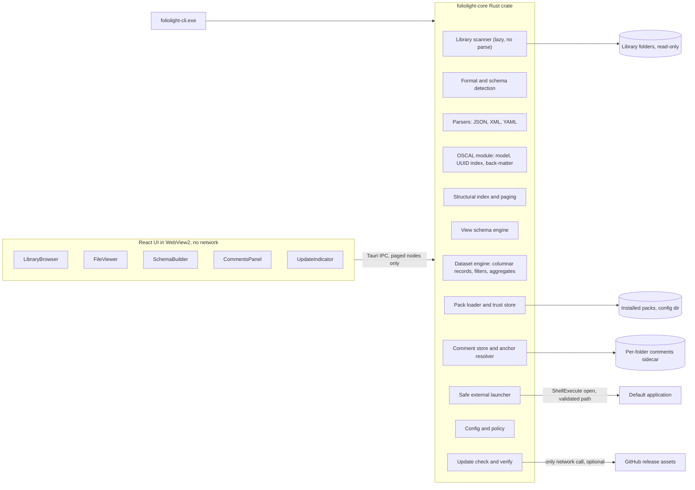
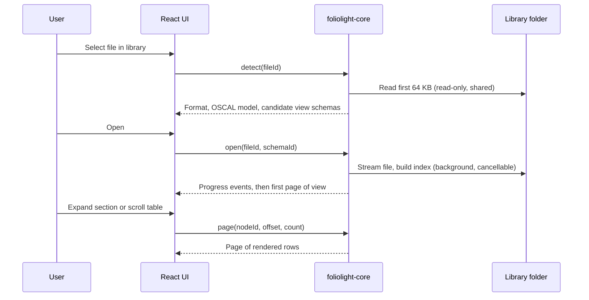

# Foliolight Project Plan

Status: Draft for maintainer and community review. Planning only; no application code exists yet.

Foliolight is a free, fully local, open-source viewer that turns machine-readable security packages into something a human can read, filter, and review. Think of it as a "PDF reader for machine-readable authorization packages."

## How to read this plan

- This file is the master plan. Detailed specifications live under [docs/specs/](specs/), the threat model under [docs/security/](security/), the release plan under [docs/release/](release/), the test strategy under [docs/testing/](testing/), and community and governance material under [docs/community/](community/).
- Anything not confirmed by the project owner is marked **ASSUMPTION** with an ID (for example, `A-07`). All assumptions are collected in [Section 16](#16-assumptions-register) so they can be confirmed or overturned in one place.
- Questions for the wider community are in [docs/community/open-questions.md](community/open-questions.md). Questions still waiting on the project owner are in [Section 17](#17-questions-still-needed-from-the-project-owner).
- Numbers such as binary sizes and memory use are estimates for planning. They must be measured during the Phase 0 technical spike before being quoted publicly.

## Table of contents

1. [Decisions log](#1-decisions-log)
2. [Vision and naming](#2-vision-and-naming)
3. [Scope and non-goals](#3-scope-and-non-goals)
4. [Principles, stated precisely](#4-principles-stated-precisely)
5. [Architecture](#5-architecture)
6. [Technology evaluation and recommendation](#6-technology-evaluation-and-recommendation)
7. [Feature plan summaries](#7-feature-plan-summaries)
8. [UI plan summary](#8-ui-plan-summary)
9. [CLI summary](#9-cli-summary)
10. [Security summary](#10-security-summary)
11. [Release, signing, distribution, and updates summary](#11-release-signing-distribution-and-updates-summary)
12. [Repository layout and contributor experience](#12-repository-layout-and-contributor-experience)
13. [Test strategy summary](#13-test-strategy-summary)
14. [Phased roadmap and exit criteria](#14-phased-roadmap-and-exit-criteria)
15. [Risk register](#15-risk-register)
16. [Assumptions register](#16-assumptions-register)
17. [Questions still needed from the project owner](#17-questions-still-needed-from-the-project-owner)

---

## 1. Decisions log

These decisions were made by the project owner during planning.

| Topic | Decision | Notes |
| --- | --- | --- |
| UI technology | React and TypeScript are acceptable, bundled inside the app with no CDN or remote loading. | Most contributors will use AI-assisted ("vibe") coding, so a mainstream, well-documented stack matters more than any one language. |
| WebView2 | Assume the Microsoft Edge WebView2 Runtime is present. Provide a documented fixed-version fallback build. | See risk R-01 for Windows Server. |
| Windows versions | Windows 10 22H2, Windows 11, Windows Server 2019 and 2022. | x64 and ARM64 (ASSUMPTION A-10). |
| Library location | Local disks and SMB shares or OneDrive-synced folders. | Drives the scanning and refresh design. |
| Comments storage | One sidecar file per document-type folder, next to the source files. Comments anchor to stable identifiers so they survive across file versions. | See [comments-store spec](specs/comments-store.md). |
| Unwritable folders | Commenting is disabled for that folder, with a clear explanation. | No silent fallback location. |
| Concurrent reviewers | Assume one reviewer per library at a time. | External-modification detection still included. |
| Archives (.zip) | Deferred until after the beta. | Planned for Phase 7. |
| Schema format | Accept YAML and JSON. The schema builder writes canonical YAML (safe subset). | |
| Update model | Download and verify. The app never executes the download; the user replaces files manually. | |
| OSCAL coverage | All six model families: SSP, SAR, POA&M, SAP, Catalog/Profile, Component Definition. | Delivered in priority order. |
| Repository home | Propose a new neutral GitHub organization with several owners from different organizations. | |
| Team capacity | 1 to 3 part-time contributors initially. Phases are sized by scope, not dates. | |
| Charts and dashboards | Configurable charts on whatever data a document contains (for example, totals, counts by disposition, exposure class, and impact rating in vulnerability reports). Chart and page definitions are saved in the view schema bound to each document type. | See [view-schema spec](specs/view-schema.md#6a-datasets-and-derived-categories). Program-specific dashboards ship as schema packs. |
| UI prototyping | Clickable UI prototypes are tested with reviewers before the UI is built. | New Phase 0B. See [ui-prototyping](design/ui-prototyping.md). |
| Document loading | No database. Each open document is an in-memory session with an offset index and compact columnar datasets, freed when evicted. | See [parsers spec](specs/parsers-and-formats.md#11-document-sessions-and-memory-model). |
| Executable signing | Tentative: executables will probably **not** be Authenticode-signed. Releases still publish hashes, a minisign signature over the hashes, and GitHub build provenance attestations. | Consequences are in risk R-02 and the [release plan](release/release-and-distribution.md#signing). |
| Documentation layout | Master plan plus split specs. | This document set. |
| Program JSON artifacts ([issue #2](https://github.com/foliolight/foliolight/issues/2)) | Non-OSCAL JSON that declares a published program schema in `$schema` is detected and matched by pack views, with a synthetic fixture and an example pack from the start. | Core stays program-neutral. See [view-schema 6D](specs/view-schema.md#6d-where-program-specific-dashboards-live). |
| Preloaded FedRAMP JSON schemas | Foliolight ships the eleven JSON schemas FedRAMP publishes for submission artifacts, as unmodified copies in a **bundled pack** with ready-made views and an informational structure check. They are not required: the pack can be switched off, and every file opens without them. | Data in a pack, not code in the core. Redistribution terms and use of the program name are to be confirmed before launch (A-32, question 12). See [bundled-program-schemas](specs/bundled-program-schemas.md). |
| Cross-document links ([issue #3](https://github.com/foliolight/foliolight/issues/3)) | A field holding an identifier (for example, a control ID in a POA&M item) can link to the matching item in another file from the same CSP, opened on selection. | No joins, no cross-CSP links. See [view-schema 8A](specs/view-schema.md#8a-cross-document-links). |
| File identity and hash check ([issue #4](https://github.com/foliolight/foliolight/issues/4)) | The viewer's top-right corner shows the open file's name and the end of its SHA-256. Selecting it opens a popover with the full hash, a paste box to compare with a hash from the CSP, and the result of any `SHA256SUMS` file in the folder. | Wording stays narrow ("matches the hash you pasted"). See [ui 4A](specs/ui.md#4a-file-identity-badge-and-hash-check). |
| Version ordering ([issue #5](https://github.com/foliolight/foliolight/issues/5)) | Default order uses the date inside the document, then a version or date in the file name, then file modified time marked "estimated." | Rationale in 7.1 and [library-convention](specs/library-convention.md#why-the-default-is-the-date-inside-the-document); the code must carry the same rationale as a comment. |
| Checks on open ([issue #6](https://github.com/foliolight/foliolight/issues/6)) | New kinds of files get a suggested view or go to the view builder. Files in a folder with a chosen view get a quick fit check with plain-language notices for new fields, a mismatch, or an unreadable file. | See [opening-files](specs/opening-files.md). The UI says "view" and "fields," never "schema." |
| Export | Any on-screen table or chart's data exports to CSV or XLSX exactly as shown, text only (no images, attachments, formulas, or macros). Every export asks where to save, starting in Downloads, with a suggested Windows-safe file name. | Low cost because data is already in the dataset engine. See [export](specs/export.md). |
| CSV as input | CSV is accepted as a machine-readable input with minimal view requirements, and gets the same tables, charts, and dashboards as JSON and XML (for example, VDR counts). Moved from Phase 7 to Phase 2. | See [parsers-and-formats 9A](specs/parsers-and-formats.md#9a-csv-as-a-machine-readable-input). |

## 2. Vision and naming

### Name

**Foliolight** combines two ideas:

- **Folio**: a collection of pages or documents. An authorization package is exactly that: a bundle of plans, assessments, and remediation records.
- **Light**: shining a light on a package so you can read what is inside. It also signals that the tool itself is light: small, fast, and local.

### Pitch

A free, fully local, open-source viewer that turns machine-readable security packages into something a human can read, filter, and review.

### The problem

Agencies hesitate to adopt machine-readable authorization packages (OSCAL and similar formats) because they cannot easily read them. This is especially true when an agency manages packages from 30 or more cloud service providers (CSPs) and has to switch between them. A dashboard built for one CSP's package does not help; agencies need one consistent, vendor-neutral way to view packages from any CSP.

### What Foliolight is

- A **stopgap and a demonstration**. It shows agencies what modern packages make possible so they ask more of governance, risk, and compliance (GRC) vendors and enterprise-grade solutions (server storage, analysis, continuous monitoring).
- **Not a product**. No revenue plan, no service, and no expectation of indefinite maintenance. A sunset plan is part of the design (see [licensing-and-governance](community/licensing-and-governance.md#sunset-plan)).
- **Format-agnostic**. OSCAL is one important format, but OSCAL is "just" XML, JSON, or YAML with a schema. The core treats every file as structured data and layers format knowledge on top through declarative view schemas, so the tool remains useful if OSCAL falls out of favor.
- **Vendor-neutral and community-built**, developed with industry partners through a CSP trade organization and the wider community.

## 3. Scope and non-goals

### In scope for 1.0

- Folder-based package library with lazy listing, version awareness, and configurable mapping rules.
- Viewers for generic JSON, XML, and YAML, plus OSCAL-aware views for all six OSCAL model families.
- Inline rendering of embedded images (including OSCAL back-matter base64 resources) and safe launching of linked local files.
- Configurable charts, tiles, and dashboard pages built from whatever data a document contains (for example, vulnerability totals by disposition, exposure class, and impact rating, or POA&M items by status and due date). They are defined in view schemas, saved per document type, and drawn by Foliolight itself.
- Declarative view schemas, a schema builder UI, and schema packs with a trust model.
- Local comments with drift handling and export.
- A CLI companion that shares the same core library.
- Optional, disableable update check with download-and-verify.
- Section 508 and WCAG 2.1 AA accessibility.

### Explicit non-goals

| Non-goal | Why |
| --- | --- |
| Editing or authoring packages | Read-only by design. Authoring is the job of GRC tools. |
| Server, multi-user, or cloud features | The point is a local tool with nothing to accredit beyond the desktop. |
| Continuous monitoring, scoring, or risk analysis | That is what agencies should demand from enterprise solutions. Counting and grouping what a document already says (charts, tiles) is in scope; computing new scores or risk ratings is not. |
| Trends across versions or across CSPs in v1 | Charts cover one document at a time. Cross-document views would need library-wide parsing; candidate after 1.0. Cross-document **links** (opening the matching item in another file of the same CSP) are in scope; joined or merged views are not. |
| Authoritative validation or compliance determinations | Foliolight is a reader. It is not a substitute for official review. The structure check against published schemas is informational only, and a hash match only means the bytes match the hash supplied. |
| Telemetry, analytics, crash upload, accounts, licensing servers | Principle 1. |
| Fetching remote content (images, imports, catalogs, URLs) | Principle 2. Remote references are shown, never fetched. |
| Running code from packs, schemas, or packages | No scripts, macros, templates with logic, or plug-in code at runtime. |
| Rendering Visio, draw.io, PlantUML, Mermaid, or PDF content inside the app in v1 | Out of scope for v1. These open in the user's default application. Mermaid or draw.io rendering may be revisited after 1.0. |
| Profile resolution that requires fetching remote catalogs | Imports are shown as links; local imports inside the library may be followed later. |
| Program-specific logic (for example, a specific government program's OSCAL extensions) in the core | Core code stays vendor- and program-neutral. Program-specific views and published schemas are data in packs. The one exception to "partners deliver them" is the bundled FedRAMP JSON schema pack, which ships with the app but is still a removable, optional pack (see [bundled-program-schemas](specs/bundled-program-schemas.md)). |
| Background services, scheduled tasks, auto-start, drivers, shell extensions | Principle 3. |

## 4. Principles, stated precisely

The original principles are kept. Some are restated more precisely so they can be tested.

| # | Principle | Precise, testable statement |
| --- | --- | --- |
| 1 | Entirely local | No network I/O from any component except the update checker. The web UI has no network access at all (enforced by content security policy). Verified by an automated test that runs the app under a network monitor and asserts zero connections when updates are disabled. |
| 2 | One optional network call | The update checker makes at most one manifest request per launch (and no more than once per 24 hours), plus downloads only when the user clicks "Download and verify". It is disabled by policy or setting for air-gapped environments, and failure is never blocking. |
| 3 | Nothing in the background | No services, scheduled tasks, Run keys, startup folder entries, drivers, shell extensions, or file associations. No registry writes at all (ASSUMPTION A-19). Process exits when the window closes. |
| 4 | Portable first | Runs from any folder, including USB, without admin rights. Portable mode keeps all state next to the executable. Agency approval realities are discussed in [open questions](community/open-questions.md#2-portable-versus-installed). |
| 5 | Read-only for package files | Foliolight never modifies, moves, renames, or deletes package files. Files are opened with read access and permissive sharing so CSP sync tools are never blocked. The **only** file Foliolight may write inside a library folder is its own comments sidecar, and only after the user adds a comment. Folder scaffolding happens only by explicit CLI or UI command. Exports (CSV and XLSX) are new files written only where the user chooses in a Save As dialog that starts in Downloads, with an extra confirmation if the user picks a library folder. When a file seems to be in the wrong folder, Foliolight offers "Show in File Explorer" and a config mapping rule; it never moves the file itself. |
| 6 | Light and fast | Lazy everywhere: list first, parse only when opened, page large trees on demand. Performance budgets are in [test strategy](testing/test-strategy.md#6-performance-budgets). |
| 7 | Easily patchable | Small artifacts, few dependencies, pinned toolchains, and an engine (WebView2 evergreen) that Microsoft patches independently. |
| 8 | Permissive license | Apache-2.0 with DCO sign-off. See [licensing-and-governance](community/licensing-and-governance.md). |
| 9 | Accessible | WCAG 2.1 AA and Section 508. An Accessibility Conformance Report (ACR) based on VPAT 2.x (Section 508 edition) is published at 1.0. |

**Challenge to principle 5.** The owner chose sidecar comments next to source files. That is a deliberate exception to "never write to source folders," and it carries two risks the docs must state plainly: the sidecar travels with the folder if it is copied, zipped, or sent back to a CSP; and an OneDrive-synced library will sync the sidecar to that user's OneDrive. The UI warns about both the first time a comment is added in a library (see [comments-store spec](specs/comments-store.md#9-sensitivity-warnings)).

## 5. Architecture

### Component diagram



### Components

| Component | Responsibility | Key constraints |
| --- | --- | --- |
| Library scanner | Enumerate CSP and document-type folders, apply mapping rules, report name, type, size, and modified time. | Never reads file contents during listing. Does not follow symlinks or junctions. Skips OneDrive cloud-only placeholders for any content sniffing. |
| Detection | Decide format (JSON, XML, YAML, others), OSCAL model and version, and matching view schema. | Reads at most the first 64 KB for sniffing, and only when the user selects a file. |
| Parsers | Convert bytes to a unified node model with byte spans. | Hard limits on size, depth, node count, string length. No DTDs, no YAML aliases. |
| Structural index | For large files, build an offset index incrementally and serve child pages on demand. | UI never receives a whole large document; it requests pages. |
| OSCAL module | Model detection, UUID index, back-matter resource resolution, internal `#uuid` link resolution, Markdown rendering of markup fields. | No remote fetches. Imports are displayed, not resolved remotely. |
| View schema engine | Apply a view schema to the node model to produce pages, sections, tables, fields, and dashboards. | Declarative only. Bounded path language. No expressions. |
| Dataset engine and document sessions | Extract the records a view declares into compact in-memory columns in the same streaming pass as indexing; serve filters, sorting, paging, and chart aggregates. Holds each open document's session, keeps the most recent few, and frees the rest. | No database and nothing written to disk. Aggregates cover all records, not just visible rows. |
| Pack loader and trust store | Discover, validate, verify, and install schema packs. | Packs contain no executable content. Hash and signature checks. |
| Comment store | Read and write per-folder sidecars, resolve anchors, detect drift, export. | Atomic writes. Disabled when folder is unwritable. |
| Safe launcher | Open linked local files in the default application. | Path must canonicalize inside the library root. Executable types always blocked. Confirmation for unknown types. |
| Config and policy | Resolve config location (portable or per-user), apply admin policy file. | Policy overrides user settings. |
| Updater | Fetch signed manifest, compare versions, download and verify on request. | Runs in Rust, not the web view. Never blocks. Never executes downloads. |
| CLI | Scriptable access to the same core functions. | Same crate, separate console binary. JSON output option. |

### Opening a file: data flow



### Crate and package layout

- `crates/foliolight-core`: all logic listed above. No UI dependencies. Unit-tested and fuzzed.
- `crates/foliolight-cli`: console binary using `foliolight-core`.
- `app/src-tauri`: thin Tauri shell exposing a small, explicit set of IPC commands.
- `app/ui`: React and TypeScript UI built with Vite. Talks only to IPC commands.

Two executables ship together: `foliolight.exe` (GUI subsystem) and `foliolight-cli.exe` (console subsystem). A single Windows executable cannot cleanly be both a windowed app and a well-behaved console program (it either flashes a console window or loses stdout in scripts), so two small binaries sharing one core is the cleaner design. This satisfies "same core library."

### Extensibility model

- **Formats** are compiled-in Rust modules implementing a parser interface, contributed by pull request with fuzz targets and fixtures. There is no runtime loading of code (no DLL plug-ins, no WebAssembly plug-ins in v1). This keeps the security story simple and the binary auditable.
- **Views** are declarative view schemas, and **schema packs** bundle them. This is where most community and partner contribution is expected, and it requires no programming.
- See [parsers-and-formats](specs/parsers-and-formats.md) for the parser interface and how to propose a new format.

## 6. Technology evaluation and recommendation

### Criteria

Binary size, startup time, memory, no runtime dependencies on agency machines, portability, code signing and antivirus false-positive risk, ease of community contribution (including AI-assisted contribution), accessibility, cross-platform potential, parsing performance for large XML and JSON, and long-term maintainability for a low-maintenance project.

### Comparison

Values are planning estimates and must be measured in the Phase 0 spike.

| Criterion | Tauri 2 (Rust + React) | Wails 2 (Go + React) | .NET 8 WPF (self-contained) | .NET 8 Avalonia | Electron | Python (PyInstaller + Qt or Tk) |
| --- | --- | --- | --- | --- | --- | --- |
| Download size | Small (about 5 to 15 MB zipped) | Small (about 8 to 20 MB) | Large (about 60 to 150 MB; WPF trims poorly) | Medium to large (about 30 to 80 MB trimmed) | Large (about 80 to 150 MB) | Medium to large (about 30 to 100 MB) |
| Startup | Fast | Fast | Moderate | Moderate | Slow to moderate | Slow, especially one-file mode (extracts to temp) |
| Memory at idle | Moderate (WebView2 processes dominate) | Moderate (same) | Low to moderate | Low to moderate | High | Moderate |
| Runtime dependency | WebView2 (present on Windows 10 and 11; not on Server by default) | WebView2 (same) | None | None | None (bundles Chromium) | None (bundles interpreter) |
| Portable | Yes, single exe | Yes, single exe | Yes, single exe | Yes | Yes, folder | Yes, but one-file mode extracts to temp |
| Signing and AV false positives | Low risk when signed (plain native exe) | Low to moderate (Go binaries are sometimes flagged) | Low to moderate | Low to moderate | Low when signed | High (PyInstaller bootloaders are frequently flagged) |
| Security patching burden | Low: Microsoft patches the WebView2 engine | Low (same) | Low to moderate (.NET runtime is bundled, so we must ship .NET security patches) | Same as WPF | High: we must ship a new Chromium every few weeks to stay patched | Moderate: interpreter and Qt bundled |
| Contributor pool | Very large for React and TypeScript UI; smaller for the Rust core | Large for UI; Go is easy to learn | Large C# pool, Windows-centric | Moderate | Very large | Large for Python; small for desktop packaging |
| AI-assisted contribution | Good: TypeScript and Rust both have strong tooling; Rust's compiler catches many mistakes before review | Good | Good | Fair (less training material) | Good | Good for logic, weak for packaging |
| Accessibility | Good: standard HTML and ARIA exposed through WebView2 to UI Automation | Good (same engine) | Excellent: mature UI Automation support | Improving, historically weaker with screen readers | Good | Qt fair, Tk poor |
| Cross-platform later | Yes (macOS WebKit, Linux WebKitGTK, with rendering differences) | Yes (same caveats) | No (Windows only) | Yes | Yes | Yes |
| Large XML and JSON parsing | Excellent (serde_json, quick-xml; streaming and memory-safe) | Good (encoding/xml is slower) | Excellent (System.Text.Json, XmlReader) | Excellent | Fair (JavaScript heap limits) | Fair (slow; C extensions help) |
| Dependency license risk | Low (MIT and Apache-2.0 ecosystem) | Low | Low | Low | Low | High for Qt: PySide6 and PyQt are LGPL or GPL, which our dependency policy forbids |
| Maintenance outlook | Tauri 2 stable and active | Wails 2 stable; next major version still in development | Microsoft-supported, LTS cadence | Active community and commercial backing | Very active, but high churn | Packaging churn |

### Recommendation: Tauri 2 with a Rust core and a React plus TypeScript UI

Why:

1. **Smallest, most patchable artifact.** Because the browser engine is the system WebView2, Microsoft patches the engine through Edge and Windows Update. That matters most for a low-maintenance project; Electron would require us to ship a new release every few weeks just to stay patched.
2. **Safe parsing of untrusted input.** Rust gives memory safety, and quick-xml does not process DTDs or external entities at all, so whole classes of XML attacks are not possible by construction.
3. **Strong security model for the UI.** Tauri 2 has an explicit capability and permission system and supports a strict content security policy. The web view can be denied all network access, which makes "entirely local" enforceable, not just a promise.
4. **Accessibility.** Standard HTML with ARIA is the most widely understood accessibility model among contributors, and WebView2 exposes it to Narrator, NVDA, and JAWS.
5. **Contribution.** Most feature work (views, schema builder, comments UI) happens in React and TypeScript, which has the largest contributor pool and the best AI-assisted coding support. The Rust core is small, heavily tested, and gated by CODEOWNERS review.
6. **Cross-platform path** to macOS and Linux exists if the community wants it.

### Where a different choice would be better

- **Choose .NET 8 WPF** if agencies cannot rely on WebView2 (for example, if most target machines are Windows Server images without it) or if accessibility testing in the Phase 0 spike shows WebView2 plus a virtualized tree cannot meet WCAG 2.1 AA. WPF has the most mature Windows accessibility, at the cost of a larger artifact and Windows-only scope.
- **Choose Go with Wails** if the Phase 0 spike shows Rust is a real barrier for the contributors who show up. The architecture stays the same; only the core language changes.
- **Avoid Electron** because of size, memory, and patch cadence.
- **Avoid Python with PyInstaller** for the shipped app because of antivirus false positives, startup time, and Qt licensing. Python remains a good choice for **developer tooling**, such as the synthetic fixture generator, where it never ships to agencies.

### Phase 0 technical spike (decision gate)

Before committing, build a throwaway prototype that:

1. Opens a 200 MB generated JSON file and a 200 MB XML file and shows the first page of a virtualized tree within the [performance budgets](testing/test-strategy.md#6-performance-budgets).
2. Passes a basic NVDA and Narrator walkthrough of the virtualized tree and a data table.
3. Produces a signed (test certificate) portable exe and runs as a standard user under default AppLocker rules when placed in an allowed path.
4. Runs on Windows Server 2022 with the fixed-version WebView2 build.

If items 1 or 2 fail and cannot be fixed within the spike, switch to .NET 8 WPF. If contributor feedback shows Rust is blocking, switch the core to Go with Wails.

## 7. Feature plan summaries

### 7.1 Folder-based package library

Full spec: [specs/library-convention.md](specs/library-convention.md).

- Default convention: `Packages/<CSP>/<DocType>/<files>` with document types `SSP`, `SAP`, `SAR`, `POAM`, and `Other` (ASSUMPTION A-14 adds `SAP` to the example layout because SAP is an in-scope OSCAL model).
- Optional `foliolight-library.yaml` at the library root, or rules stored in app config, maps arbitrary folder names to document types using case-insensitive names, aliases, globs, or regular expressions.
- Lazy listing: names, types (by extension), sizes, and modified dates only. Content sniffing happens only on selection.
- "Current" file per document type: **challenge** to the original idea of "most recently modified" ([issue #5](https://github.com/foliolight/foliolight/issues/5)). The default `auto` order is:
  1. The date inside the document (OSCAL `metadata/last-modified`, or a date field named by the view or pack), read from the first 64 KB of each file only when that folder is expanded.
  2. A version or date in the file name (for example `ssp-v4` or `2026-10`).
  3. File modified time, with the ordering marked "estimated."

  **Why:** ideally agencies add files one by one as they download them and never modify them, so modified times would stay in order. But copying, unzipping, restoring, or syncing a folder can reset those times, while the date the provider's tool wrote inside the file does not change. Version numbers or dates in file names, where providers use them, are the next best indicator of which file is latest. Modified time stays as the fallback because every file has one. This rationale must also appear as a comment in the ordering code. When the two orders disagree, the folder shows a short note. Rules can force one strategy, and the user can always pin a different file as current.
- Older versions are listed under the current file and can be opened or compared side by side in a later phase.
- Large libraries: streaming enumeration, per-folder lazy expansion, depth limits, no symlink or junction following, and manual or on-focus refresh for network shares where change notifications are unreliable.

### 7.2 Rendering and viewing

Full spec: [specs/parsers-and-formats.md](specs/parsers-and-formats.md).

- Three viewer modes for every file: **Outline** (navigable tree), **Document** (sections, fields, and tables driven by a view schema), and **Source** (read-only text with line numbers and syntax highlighting, paged for large files).
- Search across the open file (keys and values), filters on table columns, collapse and expand all, breadcrumbs, and jump to OSCAL UUID or control ID.
- v1 formats: JSON, XML, YAML, with OSCAL awareness for all six models, and **CSV as a first-class machine-readable input** (below). Roadmap: XLSX (many POA&M deliverables are spreadsheets), SARIF, CycloneDX, SPDX, Markdown, then archives.
- **CSV input** (Phase 2, alongside the dataset engine). Some providers deliver vulnerability detail reports, inventories, or POA&M lists as CSV while others use JSON or XML, so CSV gets the same tables, filters, charts, and dashboards. Spec: [parsers-and-formats Section 9A](specs/parsers-and-formats.md#9a-csv-as-a-machine-readable-input).
  - **Limited schema needs:** a CSV opens immediately as a sortable, filterable table, with "Chart this column" on every header and no view needed. A view only has to map column headers to field names (and, where needed, date formats) to unlock saved dashboards.
  - **Same dashboard, different formats:** a CSV view can extend a JSON or XML view and replace only its dataset mapping, so a VDR dashboard shows the same counts (totals, dispositions, IRV+LEV, NIRV+LEV, NLEV, impact ratings) whether one CSP sends JSON and another sends CSV.
  - CSV is treated as untrusted input like everything else: formulas are shown as text and never evaluated, and size, row, column, and cell limits apply.
- Images: PNG, JPEG, GIF, WebP, BMP, and SVG render inline when embedded as base64 (for example, OSCAL back-matter `base64` resources) or when linked files are inside the library. SVG renders only through an image element, which cannot run scripts or load external resources.
- Linked local files (PDF, DOCX, XLSX, VSDX, and others) show an "Open in default app" action that goes through the [safe launcher](security/threat-model.md#safe-external-launch).
- Remote URLs are shown as text with "Copy link." Opening them in a browser is an opt-in setting with confirmation (ASSUMPTION A-01).
- Charts and dashboards: view schemas declare **datasets** (the records to count, such as findings), **derived categories** (declarative rules, such as "internet-reachable and likely exploitable"), and **dashboard pages** of tiles and charts: bar, stacked bar, donut, matrix, timeline, and top-N tables. Selecting any bar or tile opens the matching rows as a filtered table. Any table column can be charted ad hoc and saved to the view. Charts are drawn as accessible SVG, each with a "Show as table" alternative. Full spec: [view-schema Sections 6A to 6D](specs/view-schema.md#6a-datasets-and-derived-categories).
- Rendering diagrams contained in package content (Visio, draw.io, and similar) is out of scope for v1. Those open in the default application.
- How files are read and held in memory: see [Section 7.7](#77-document-loading-and-memory).
- **File identity badge** ([issue #4](https://github.com/foliolight/foliolight/issues/4)): the top-right of the viewer shows the open file's name and the last 8 characters of its SHA-256 (computed during the indexing read). Selecting it opens a popover with the full hash, a copy button, and a paste box that compares with a hash from the CSP as soon as it is pasted (accepts SHA-256, SHA-384, and SHA-512; explains why MD5 and SHA-1 are not used, ASSUMPTION A-27). If the folder has a `SHA256SUMS` style list, the popover shows its result too. A match is described only as "matches the hash you pasted." Spec: [ui 4A](specs/ui.md#4a-file-identity-badge-and-hash-check).
- **Cross-document links** ([issue #3](https://github.com/foliolight/foliolight/issues/3)): a view can declare that a field holds an identifier found in another file from the same CSP (for example, a POA&M item's control ID in the current SSP). Selecting it opens that file at the match, building the target's ID index only on demand. No joins or cross-CSP links. Spec: [view-schema 8A](specs/view-schema.md#8a-cross-document-links).
- **Checks on open** ([issue #6](https://github.com/foliolight/foliolight/issues/6)): see [opening-files](specs/opening-files.md).
  - A new kind of file gets a suggested installed view ("Use for this folder," "Just this file," "See other views," or "Build my own"). If there is no match, or the reviewer declines, the view builder opens with a draft.
  - A file in a folder with a chosen view gets a quick fit check (target under 200 ms) with one of four outcomes:
    - Fits: nothing extra is shown.
    - Fits, with differences: a notice for new or missing fields, offering to add the new fields to the folder's view or save a new one.
    - Does not fit: suggests other views, building a view, or treating such files as a different document type through config. Foliolight never moves the file.
    - Cannot read: a plain-language explanation, the readable part as text, and copyable details.
  - A background informational structure check against the published schema runs for OSCAL from Phase 2 and for pack-supplied schemas from Phase 4.
  - Outline and Source views are always one click away.
- **Export** to CSV and XLSX of any on-screen table, drill-down, or chart's data, with the same columns, filters, and sort as the screen. The data is already in the dataset engine, so export streams rows with constant memory. Exports are text only: images and attachments become placeholders, cells are never formulas, links are plain text, and the file is `.xlsx`, never `.xlsm`. Every export opens a Save As dialog that starts in Downloads and suggests a name like `vuln-2026-10 - VulnReports - Open findings.xlsx`, built from the source file name, document type, and page, with characters Windows does not allow removed. Exports include an "About this export" sheet (or `.about.txt` for CSV) naming the source file and its hash, and policy can disable export. Spec: [export](specs/export.md).

### 7.3 View schemas, schema builder, and schema packs

Full specs: [specs/view-schema.md](specs/view-schema.md) and [specs/schema-pack.md](specs/schema-pack.md).

- View schemas are YAML or JSON files with `apiVersion: foliolight/view-schema/v1`, validated by a published JSON Schema. YAML is the canonical output because it supports comments and diffs cleanly; JSON is accepted for tools that generate schemas.
- A small, bounded path language (FPath) works the same over JSON, YAML, and XML. There are no expressions, scripts, or templates with logic.
- Built-in OSCAL views are themselves view schemas. This dogfoods the format and means partners can override or extend them.
- The schema builder infers a draft schema from a sample file, then lets the user adjust labels, sections, ordering, columns, grouping, formatting, hidden fields, and link handling with a live preview. It is also where the open flow sends reviewers when no view fits, and where "Add the new fields to this folder's view" lands. Updating a built-in or pack view saves a personal copy that extends it.
- **Preloaded program schemas:** the app ships a bundled pack containing the JSON schemas FedRAMP publishes for submission artifacts (unmodified copies), views for them, and dashboards for the vulnerability-related ones. It gives detection by `$schema`, a suggested view, and an informational structure check with no setup. The schemas are not required, so the pack can be switched off by the user or by policy. Spec: [bundled-program-schemas](specs/bundled-program-schemas.md).
- View schemas declare **fit rules** (fields a file must have, fields the view expects, where to watch for new fields) used by the quick fit check, and may name a published **structure schema** for the informational check. Matching on `$schema` accepts globs so one view can cover several published versions.
- Schema packs are folders with a manifest, schemas, checksums, and an optional signature. Packs are namespaced by `publisher/pack`, use semantic versioning, and have four trust levels. Packs never contain executable content, and the validator rejects any file type outside a small allowlist.

### 7.4 CLI companion

Full spec: [specs/cli.md](specs/cli.md). Summary in [Section 9](#9-cli-summary).

### 7.5 Local comments and annotations

Full spec: [specs/comments-store.md](specs/comments-store.md).

- One `.foliolight-comments.yaml` sidecar per document-type folder (owner decision).
- Comments anchor to stable identifiers first (OSCAL control ID, OSCAL UUID, POA&M item ID), with structural pointers (JSON Pointer, simplified XPath, line range) as fallback. Each comment records a content fingerprint of the anchored node and a history of the files and file hashes it has been seen in.
- When a newer file is dropped in, each comment resolves to **Attached** (anchor found, content unchanged), **Changed** (anchor found, content changed since the comment), or **Orphaned** (anchor not found). Orphaned comments are never deleted automatically; the user can re-anchor, convert to a file-level comment, resolve, or delete.
- Export to Markdown, CSV (with spreadsheet formula injection protection), and JSON.
- If the folder is not writable, commenting is disabled for that folder with an explanation (owner decision).

### 7.6 Update checking

Full plan: [release/release-and-distribution.md](release/release-and-distribution.md#update-check-and-download-and-verify).

- **Challenge** to "check GitHub releases": the GitHub REST API allows 60 unauthenticated requests per hour per IP address, and many agency users share one outbound address, so API-based checks would fail often. Instead, the app fetches a small signed `latest.json` file attached to each release via the `releases/latest/download/` URL, which is served as a release asset rather than through the rate-limited API.
- At most once per 24 hours, 5 second timeout, system proxy settings, operating system certificate store (so agency TLS inspection works).
- Failure never blocks. A small status icon with a tooltip shows: Up to date, Update available, Could not check (with reason and last successful check), Disabled, Downloading, Verified, or Verification failed.
- "Download and verify" saves the release zip to a user-chosen folder, verifies the signed manifest and SHA-256 hash, and then offers "Open folder" with replacement instructions. The app never runs the download.
- A setting and an admin policy file disable the check entirely. Whether the check is on by default is ASSUMPTION A-15.

### 7.7 Document loading and memory

Full spec: [parsers-and-formats Section 11](specs/parsers-and-formats.md#11-document-sessions-and-memory-model).

- No database import. One streaming, read-only pass builds an offset index plus compact columnar datasets containing only the fields the active view needs.
- The UI receives small pages and aggregate counts over IPC, never the whole document.
- Each open document is an in-memory session. The 3 most recent sessions are kept, within a 768 MB total cap (ASSUMPTION A-26), so switching back is instant. Older sessions are freed. Nothing is written to disk.
- Work runs on capped background threads with cancellation, so the UI stays responsive on 2-core virtual desktops.

## 8. UI plan summary

Full spec with text wireframes and accessibility details: [specs/ui.md](specs/ui.md). Clickable prototypes are tested with reviewers before UI build-out: [design/ui-prototyping.md](design/ui-prototyping.md).

```
+----------------------------------------------------------------------------------+
| Foliolight   [Library: Agency packages v]   [Search this file...      ]  (i) [*] |
+-------------------------+------------------------------------+-------------------+
| LIBRARY                 | Aster Example Cloud > SSP          | DETAILS | COMMENTS|
| v Aster Example Cloud   | ssp-2026-10.json  (current)        |                   |
|   v SSP                 | [Document] [Outline] [Source]      | Control AC-2      |
|     * ssp-2026-10.json  | -------------------------------    | Status: Partial   |
|       ssp-2026-07.json  | System overview                    |                   |
|   > SAR                 | Control implementations (325)      | 2 comments        |
|   > POAM                |  Filter: [Family v] [Status v]     |  - Open: Clarify  |
| > Brightwater Example   |  AC-1  Implemented                 |    account review |
| > Cobalt Example        |  AC-2  Partial          [2 notes]  |                   |
+-------------------------+------------------------------------+-------------------+
| JSON  OSCAL SSP 1.1.2  View: builtin oscal/ssp  Parsed 12.4 MB in 0.8 s          |
+----------------------------------------------------------------------------------+
```

Accessibility highlights: every function reachable by keyboard, ARIA treeview and grid patterns with `aria-setsize`, `aria-posinset`, `aria-rowcount`, and `aria-rowindex` so virtualized lists still announce position, Windows high contrast via `forced-colors`, 200 percent zoom and reflow, no color-only status, polite live regions for progress, and a tested matrix with Narrator, NVDA, and JAWS.

## 9. CLI summary

Full spec: [specs/cli.md](specs/cli.md).

```
foliolight-cli library add <path> [--name <name>]
foliolight-cli library list
foliolight-cli library verify [<library>]
foliolight-cli csp scaffold <library> <csp-name> [--types SSP,SAP,SAR,POAM,Other]
foliolight-cli detect <file> [--fit]
foliolight-cli hash <file>... [--expect <hash>] [--sums <SHA256SUMS>]
foliolight-cli export <file> --dataset <id> [--filter <field>=<value>]... --format csv|xlsx --out <file>
foliolight-cli schema infer <sample-file> --out <schema.yaml> [--id <publisher/name>]
foliolight-cli schema validate <schema-file>...
foliolight-cli pack validate <pack-folder>
foliolight-cli pack install <pack-folder> [--trust-key <key.pub>] [--allow-unsigned]
foliolight-cli pack list
foliolight-cli pack verify [<pack-id>]
foliolight-cli comments export <library> [--csp <name>] --format md|csv|json --out <file>
foliolight-cli config path | get <key> | set <key> <value>
foliolight-cli update check
foliolight-cli update verify <downloaded-zip>
foliolight-cli doctor
```

Every command supports `--json` with a stable envelope, never prompts unless `--interactive` is given, and uses documented exit codes.

## 10. Security summary

Full threat model: [security/threat-model.md](security/threat-model.md).

| Area | Primary controls |
| --- | --- |
| Untrusted parsing | Reject XML DTDs entirely (no external entities, no entity expansion), reject YAML aliases and custom tags, limits on file size, depth, node count, string length; fuzzing for every parser. |
| Embedded and linked content | No remote fetches ever. Images rendered only as images; SVG only through image elements; Markdown rendered without raw HTML; strict content security policy with no network origins. |
| Path handling | Links must canonicalize inside the library root; UNC and `file://` remote paths from content are never touched (prevents NTLM credential leaks); reparse points not followed; Windows device names and alternate data streams rejected. |
| External launch | Default application via the operating system "open" verb with no arguments; executable and script types always blocked; unknown types require confirmation. |
| Local data | No caches of content on disk; decoded attachments are saved only where the user chooses; logs contain no content; sidecars inherit folder permissions. |
| Supply chain | Minimal dependencies, lockfiles, cargo-deny and cargo-audit, license scanning, SBOM, build provenance attestations, pinned toolchains and GitHub Actions, two-maintainer release approval. |
| Locked-down Windows | No admin rights, no registry, published hashes for AppLocker and WDAC hash rules (Authenticode only if adopted later), graceful handling of blocked writes. |
| Disclosure | GitHub private vulnerability reporting, documented in [SECURITY.md](../SECURITY.md). |

## 11. Release, signing, distribution, and updates summary

Full plan: [release/release-and-distribution.md](release/release-and-distribution.md).

- Primary artifact: a portable zip per architecture containing both executables, README, LICENSE, NOTICE, third-party license inventory, and SBOM. A larger fixed-version WebView2 variant exists for Windows Server.
- Each release publishes `SHA256SUMS`, a minisign signature over the checksums, a signed `latest.json`, a CycloneDX SBOM, and GitHub build provenance attestations.
- Tentative decision: executables will probably not be Authenticode-signed. Integrity and origin are proven by the minisign-signed hashes and GitHub build provenance attestations. The cost is SmartScreen warnings, Smart App Control blocks, and hash-only allowlisting (risk R-02). If signing is adopted later, Azure Trusted Signing (Microsoft's managed signing service) is the preferred option, subject to eligibility of whichever legal entity holds the signing identity (ASSUMPTION A-03).
- An MSI and a winget manifest are deferred; MSIX is not recommended because its container model complicates arbitrary folder access.
- Manual update path for air-gapped agencies: download on a connected machine, verify with `foliolight-cli update verify` or standard tools, transfer through approved media, and update allowlist hashes.

## 12. Repository layout and contributor experience

### Target layout

```
foliolight/
  README.md                 Pitch, naming, disclaimer, quick start
  LICENSE                   Apache-2.0, official text
  LICENSES/                 REUSE license texts
  NOTICE                    Attribution notice
  DCO                       Developer Certificate of Origin 1.1, official text
  CONTRIBUTING.md           How to contribute, DCO sign-off, AI-assisted contribution policy
  CODE_OF_CONDUCT.md        Contributor Covenant 2.1
  SECURITY.md               Vulnerability disclosure
  TRADEMARKS.md             Name and logo policy
  GOVERNANCE.md             Roles, decisions, releases, sunset
  REUSE.toml                Licensing annotations for files without headers
  .github/
    ISSUE_TEMPLATE/         Bug, feature, format or schema request, config
    PULL_REQUEST_TEMPLATE.md
    CODEOWNERS
    workflows/              CI (Phase 0)
  crates/
    foliolight-core/        Parsing, detection, views, packs, comments, updates
    foliolight-cli/         Console binary
  app/
    src-tauri/              Tauri shell and IPC commands
    ui/                     React and TypeScript UI
  schemas/
    spec/                   JSON Schemas: view schema, pack, comments, config, library
    builtin/                Built-in view schemas (OSCAL and generic)
  packs/
    examples/               Example schema packs for partners to copy
  fixtures/
    generator/              Python generator for synthetic packages (dev only)
    library/                Generated small synthetic library (committed)
    malicious/              Hostile inputs for security tests
  docs/                     This plan and specifications
```

### Contributor experience

- License: Apache-2.0. Contribution terms: Apache-2.0 Section 5 (inbound equals outbound) plus DCO sign-off (`git commit -s`). No CLA and no separate signed documents.
- AI-assisted contributions are welcome. The contributor is responsible for the change, must understand it well enough to answer review questions, and certifies the DCO as usual.
- CODEOWNERS requires a core maintainer review for security-sensitive paths (parsers, launcher, updater, config and policy, CI and release workflows).
- Issue templates warn people not to attach real package data and steer them toward the synthetic fixtures.
- Details: [community/licensing-and-governance.md](community/licensing-and-governance.md) and [CONTRIBUTING.md](../CONTRIBUTING.md).

## 13. Test strategy summary

Full strategy: [testing/test-strategy.md](testing/test-strategy.md).

- Three fictional CSPs with deliberately different layouts and formats: **Aster Example Cloud** (standard layout, JSON), **Brightwater Example Hosting** (nonstandard folder names needing mapping rules, XML), and **Cobalt Example Systems** (deep nesting, many files, YAML and mixed formats, attachments, multiple versions for drift tests).
- Generated by a deterministic, dev-only Python script. Only example.com domains, documentation IP ranges, and obviously fictional names. A CI check scans fixtures for real-looking data.
- Hostile-input corpus, parser fuzzing, large-file performance tests generated at test time, CLI golden tests, UI component and end-to-end tests, automated accessibility checks, manual screen reader passes, and a Windows environment matrix including Server, standard users, AppLocker, SMB, and OneDrive placeholders.

## 14. Phased roadmap and exit criteria

Phases are sized by scope, not dates, for a team of 1 to 3 part-time contributors. Phase 0B (UI prototype and feedback) was added at the owner's request and can run alongside Phase 0. The owner's requested order (beta, schema builder, packs, comments, CLI, polish) is otherwise kept, with one change: a **view schema engine** phase comes before the schema builder, because built-in OSCAL views are expressed as view schemas and the builder needs the engine to preview its output. CLI commands also ship incrementally with the features they serve, since the CLI shares the core.

| Phase | Scope | Exit criteria |
| --- | --- | --- |
| 0. Foundations | Repository and org, policy files, CI (build, lint, tests, cargo-deny, license scan, REUSE lint, SBOM), fixture generator and synthetic library, Phase 0 technical spike and stack decision gate. | Stack decision recorded. CI green on Windows. REUSE lint passes. Fixtures generated and checked for real-looking data. Signing approach chosen or a test-signing interim documented. |
| 0B. UI prototype and feedback | Clickable prototype of the core screens (library, SSP Document view, vulnerability dashboard with drill-down, schema builder, comments, update states) using synthetic data; design tokens; moderated feedback sessions with agency reviewers and partners. See [ui-prototyping](design/ui-prototyping.md). | At least 4 of 5 participants complete each core task without help. Design tokens pass contrast checks. No open design issue that blocks a core task. |
| 1. Beta: read-only browser and basic viewer | Library browser with lazy listing, mapping rules from config, current and older versions; Outline and Source views for JSON, XML, YAML; OSCAL detection and a generic OSCAL view (metadata, back-matter, UUID links); inline images; safe launcher; update check with status icon (notify plus manual link); file identity badge and hash check popover (including folder `SHA256SUMS`); version ordering by in-document date, file name, then modified time; graceful "cannot read" panels; accessibility baseline; portable zip with hashes, minisign signature, and provenance attestation; minimal CLI (`detect`, `hash`, `library list`, `library verify`, `doctor`). | All Phase 1 features work on Windows 10, 11, and Server 2022 (fixed-version build) as a standard user. Hostile corpus passes with no crash or hang. Performance budgets met for the 100 MB fixtures. Zero network connections when updates are disabled. Keyboard-only and NVDA walkthrough of library and tree passes. Release artifacts hashed, with minisign signature, provenance attestation, and SBOM (plus Authenticode only if a signing identity exists). |
| 2. View schema engine and OSCAL views | View schema spec v1 and JSON Schema; FPath; Document view; built-in schemas for SSP, POA&M, SAR, then SAP, Catalog and Profile, Component Definition; document sessions and dataset engine; datasets, derived categories, pages, and dashboards (tiles, bar, stacked bar, donut, matrix, timeline) with drill-down and table alternatives; ad hoc "Chart this column"; schema precedence and "View as" chooser; folder view bindings, view suggestion on first open, fit rules and quick fit check with plain-language notices; informational structure check for OSCAL JSON; the bundled FedRAMP JSON schema files (with Common Definitions), `$schema` detection of those files, `PROVENANCE.yaml` and a CI hash check; cross-document links; CSV input (parser, generic table view, CSV datasets and dashboards, CSV variants of views through `extends`); CSV and XLSX export of tables and chart data; `schema validate`, `detect --fit`, `export`. | All six OSCAL models render in Document view using built-in schemas only. A synthetic vulnerability report fixture renders a dashboard whose counts match an independent script's counts exactly, and the CSV version of the same report produces identical counts. Dashboard recomputation after a filter change is under 100 ms on 200,000 records. Charts pass keyboard and screen reader checks. The open-check fixtures produce the right outcome each time, and the fit check meets its 200 ms budget. Exported files match the on-screen rows and columns exactly and pass the export injection tests. Spec published and marked v1. |
| 3. Schema builder UI | Inference from a sample, mapping editor, dataset and derived-category editor, chart and dashboard page editor, fit-rule editor in plain words, cross-document link editor, "add new fields" entry from the open notice, personal copies that extend built-in and pack views, live preview, save to user schemas, validation, `schema infer`. | A non-technical tester creates a usable view for an unfamiliar JSON or XML file in under 15 minutes in a moderated test. A tester who sees the "new fields" notice adds them to the folder's view without help. Builder is fully keyboard and screen reader operable. |
| 4. Schema packs | Pack format and validator, install from folder, drop folders, trust store, minisign verification, conflict resolution, `pack validate`, `pack install`, `pack list`, `pack verify`, example packs (including `example-publisher.vuln-report-dashboard` and `example-publisher.program-json-artifacts`), pack-supplied structure schemas for the informational check; the **bundled FedRAMP JSON schema pack** (Document views for every published schema, dashboards for the three vulnerability-related ones, About screen, on/off setting, refresh script). | An example partner pack installs, verifies, and takes precedence as documented. Tampered, unsigned, and code-containing packs are rejected or flagged as specified. The bundled pack's dashboards match an independent script's counts on data generated from the bundled schemas, and turning the pack off removes its suggestions and checks. |
| 5. Comments | Sidecar store, anchors and fingerprints, drift states, orphan handling, writability check, sensitivity warnings, export (Markdown, CSV, JSON), `comments export`. | Comments survive a version change in the Cobalt fixtures with correct Attached, Changed, and Orphaned states. Read-only folders disable commenting cleanly. Exports open correctly in common tools, and CSV injection tests pass. |
| 6. Full CLI | Remaining commands (`library add`, `csp scaffold`, `config`, `update check`, `update verify`), stable JSON envelope, exit codes, documentation. | Golden tests cover every command and JSON output. Scripts run unattended with no prompts. |
| 7. Polish and 1.0 | Download-and-verify update flow, XLSX viewer, SARIF, CycloneDX and SPDX views, read-only zip archive support with strict limits, informational structure check for OSCAL XML (XSD), side-by-side version compare, performance tuning, published ACR, full docs. | ACR published. External security review or community audit completed and findings addressed. All open questions marked critical are decided. 1.0 tagged by two maintainers. |

Post-1.0 candidates: macOS and Linux builds, MSI and winget, Mermaid or draw.io rendering, OSCAL assessment-results export of comments, localization.

## 15. Risk register

| ID | Risk | Likelihood | Impact | Mitigation |
| --- | --- | --- | --- | --- |
| R-01 | Windows Server 2019 and 2022 do not include WebView2 by default, so the standard build will not start there. | High | Medium | Fixed-version WebView2 build for Server, clear error message with remediation if the runtime is missing, document IT deployment of the Evergreen runtime. Note: the fixed-version build makes us responsible for shipping WebView2 security updates. |
| R-02 | Unsigned executables (current tentative decision) trigger SmartScreen warnings, are blocked by Smart App Control, and can only be allowlisted with per-release hash rules. | High | High | Publish hashes, minisign signatures, and provenance attestations; IT administrator guide with hash-rule instructions; revisit Authenticode signing if agencies report it blocks adoption. |
| R-03 | Maintainer attrition (stopgap project, part-time volunteers). | High | Medium | Low-maintenance architecture, sunset plan, multi-organization org owners, documented release runbook. |
| R-04 | Quality and security of AI-assisted contributions. | Medium | High | CI gates (tests, fuzz smoke, lint, cargo-deny), CODEOWNERS on sensitive paths, small PR guidance, hostile corpus regression tests. |
| R-05 | Scope creep toward a product (storage, analysis, monitoring). | Medium | Medium | Non-goals list, governance rule that new scope must fit the stopgap mission. |
| R-06 | Perceived government endorsement. | Low | High | No government marks in the product name, logo, or chrome. The bundled FedRAMP schema pack uses the program name descriptively only, with a not-affiliated disclaimer, no logos or styling, and a decision recorded in question 12. README disclaimer, trademark policy, neutral wording. |
| R-07 | Real sensitive package data posted in issues or bug reports. | Medium | High | Issue template warnings, synthetic fixtures, maintainers delete and purge sensitive attachments promptly, SECURITY.md guidance. |
| R-08 | Sidecar comments leak when folders are copied, zipped, sent to CSPs, or synced to OneDrive. | Medium | Medium | First-use warning, visible sidecar name, export-based sharing guidance, `library verify` lists sidecars. |
| R-09 | Large files exceed memory or responsiveness budgets in WebView2. | Medium | Medium | Core-side indexing and paging, virtualization, hard size limits with clear messages, Phase 0 spike. |
| R-10 | Screen reader support for virtualized trees and grids falls short of WCAG 2.1 AA. | Medium | High | Phase 0 accessibility spike, ARIA position attributes, alternate table-of-contents navigation, ACR testing; fallback to WPF if unfixable. |
| R-11 | OSCAL version churn or a major version change. | Medium | Low | OSCAL support lives mostly in view schemas, which are easy to update or replace. |
| R-12 | SMB latency and unreliable change notifications make browsing slow or stale. | Medium | Low | Lazy per-folder enumeration, manual and on-focus refresh, no reliance on file watchers for network paths. |
| R-13 | Windows Error Reporting may upload crash data to Microsoft outside our control. | Low | Medium | Document the behavior for administrators (it is governed by OS policy), avoid holding file content in long-lived memory where practical, avoid registry writes to opt out. |
| R-14 | Partner schema packs promote vendor-specific interpretations as "official." | Medium | Low | Trust levels shown in UI, pack metadata displays publisher, governance on curated packs. |
| R-15 | Spreadsheet exports spread package data beyond the controlled library, or are mistaken for official records. | Medium | Medium | Text-only exports, Save As dialog every time starting in Downloads, confirmation before saving inside the library, sensitivity reminder, "About this export" provenance with "not an official record," policy switch to disable export. |
| R-16 | Reviewers read a hash match, or a fit check that "fits," as proof a file is authentic or compliant. | Medium | Medium | Narrow wording everywhere, help text on getting hashes through a separate trusted channel, structure check labeled informational. |
| R-17 | Bundled published schemas fall behind newer versions, or are mistaken for what a program requires. | Medium | Medium | Dated versions kept side by side, "newer than this copy" message, user-added schema files, refresh script and CI job that flags upstream changes, informational wording (A-33), pack can be turned off. |

## 16. Assumptions register

Each item is an ASSUMPTION until the project owner or community confirms it.

| ID | ASSUMPTION | Where it matters |
| --- | --- | --- |
| A-01 | Remote URLs are copy-only by default. Opening them in the default browser is an opt-in setting that asks for confirmation each time. | Viewer, threat model, config |
| A-02 | The YAML parser crate (candidates: yaml-rust2 or saphyr) is chosen during Phase 0 based on safety, maintenance, and license. | Parsers |
| A-03 | Azure Trusted Signing eligibility depends on which legal entity holds the signing identity; it may need to be the trade organization or another established entity. | Release |
| A-04 | MPL-2.0 (weak copyleft) dependencies are disallowed unless granted a documented exception by maintainers. | Dependency policy |
| A-05 | The UI is English-only in v1, with strings externalized so localization is possible later. | UI |
| A-06 | OSCAL 1.1.x and later 1.x versions are supported. Pre-1.0 drafts are not. Version is read from `metadata/oscal-version`. | Parsers, view schemas |
| A-07 | Default limits: 512 MB maximum file size, nesting depth 256, 64 MB maximum single string or text node, 25 MB maximum decoded attachment, 64 MB maximum YAML file. All configurable downward by policy and upward only by explicit user setting. | Parsers, threat model |
| A-08 | The sidecar file name is `.foliolight-comments.yaml`. On Windows, the leading dot does not hide the file, which is desirable here because users should see it. | Comments |
| A-09 | The comment author label is free text set by the user on first comment. It does not default to the Windows user name, to avoid exposing account names in shared folders. | Comments |
| A-10 | Builds are produced for Windows x64 and ARM64. | Release |
| A-11 | Primary audience is United States federal agencies, but nothing in the tool is limited to them. | Docs |
| A-12 | All timestamps are stored in UTC using ISO 8601 and displayed in local time. | Comments, config |
| A-13 | The CSP display name comes from the top-level folder name and can be overridden in mapping rules. | Library |
| A-14 | The default scaffold includes `SSP`, `SAP`, `SAR`, `POAM`, and `Other` (SAP added to the owner's example). | Library, CLI |
| A-15 | The update check is **off until the user opts in** on first run (a one-time, non-blocking prompt). Admins can preset it on or off through the policy file. | Updates, config |
| A-16 | Comment text is plain text with a small safe Markdown subset (bold, italics, lists, code, links shown as text). | Comments |
| A-17 | Schema packs and update manifests are signed with minisign (Ed25519). Sigstore is offered as a community question. | Packs, release |
| A-18 | Built-in OSCAL views target the NIST OSCAL models only. Program-specific OSCAL extensions are delivered by partner packs. The only program-specific content that ships with the app is the bundled FedRAMP JSON schema pack, which is data, optional, and removable. | View schemas, governance |
| A-19 | Foliolight writes nothing to the Windows registry. | Principles, release |
| A-20 | Decoded embedded attachments (for example, a base64 PDF) are never written to temporary folders automatically. The user chooses "Save as" to a location, then may open it. | Threat model |
| A-21 | The project GitHub organization name is `foliolight`, if available. | Repository, governance |
| A-22 | Logs are off by default. When enabled, they contain no file contents, and file paths appear only at debug level. | Threat model, config |
| A-23 | Partners or agencies will provide JAWS testing. Otherwise the accessibility report documents NVDA and Narrator results only. | UI, accessibility |
| A-24 | The performance reference machine is a 4-core laptop with 8 GB RAM and an SSD, typical of agency-issued hardware. | Test strategy |
| A-25 | Field names and category definitions for program-specific vulnerability reports (for example, exposure classes and impact ratings) are confirmed with whoever publishes that format. The plan's examples use illustrative names only. | View schemas, example pack |
| A-26 | Document session cache defaults: at most 3 sessions or 768 MB total, whichever comes first. | Memory model |
| A-27 | The hash check supports SHA-256 (default), SHA-384, and SHA-512. MD5 and SHA-1 hashes are recognized by length and explained as too weak, not computed. | UI, CLI, threat model |
| A-28 | An XLSX writer crate with a streaming (constant-memory) mode and an allowed license is available (candidate: `rust_xlsxwriter`). If none passes the dependency policy, XLSX export slips and CSV ships alone. | Export, dependency policy |
| A-29 | Quick fit check defaults: sample 500 records per dataset, flag new fields present in at least 20 percent of sampled records, and refine once after full indexing. | Opening files, view schemas |
| A-30 | Every export opens a Save As dialog that starts in the user's Downloads folder (owner preference), with a suggested name of `<source file> - <document type> - <page or table>` made safe for Windows file names. Saving inside a library folder needs one extra confirmation. | Export, principles |
| A-31 | Documents that follow the FedRAMP JSON schemas carry a `$schema` value that names the published schema file, in a form a glob can match. Confirm against the published files before writing the match rules; otherwise fall back to structural matching. | Bundled schemas, detection |
| A-32 | The published FedRAMP schema files may be redistributed unmodified inside an Apache-2.0 project. The schemas page does not state terms, so this must be confirmed with the publisher before the files are committed. If not confirmed, the pack ships views only and users add the schema files themselves. | Bundled schemas, licensing |
| A-33 | The owner has stated that these schemas are not required for submissions. The plan therefore treats every check against them as informational and optional, and avoids any wording about what a program requires. | Bundled schemas, UI wording |

## 17. Questions still needed from the project owner

These are not community questions; they are inputs only the project owner (or the founding partners) can supply.

1. **Trade organization and legal entity.** Which organization (if any) will hold the GitHub org ownership, the signing identity, a domain for contact addresses, and any trademark rights? This affects signing eligibility (A-03) and governance.
2. **Contact channels.** What address or channel should receive Code of Conduct reports and security reports? GitHub private vulnerability reporting covers security, but conduct reports need a monitored address.
3. **Update check default.** Confirm A-15 (off until opt-in) versus on by default.
4. **MPL-2.0 dependencies.** Confirm A-04 (disallowed by default) or allow MPL-2.0 as file-level weak copyleft.
5. **Logo.** Will there be a logo? The trademark policy covers it either way, but artwork needs its own license decision.
6. **Beta audience.** Who are the first beta users (specific agencies, partner CSPs, the trade organization)? This sets the bar for signing and documentation at Phase 1.
7. **Cross-platform appetite.** Is macOS or Linux support something partners would fund or staff, or community-only after 1.0?
8. **Pack signing.** Confirm minisign for packs (A-17), or prefer Sigstore identity-based signing.
9. **Comments author identity.** Confirm A-09 (free text, no Windows user name default).
10. **Attachment handling.** Confirm A-20 (no automatic temp files for decoded attachments).
11. **WebView2 fixed-version build.** That build bundles Microsoft's proprietary WebView2 runtime, which conflicts with the permissive-only dependency policy. Approve a documented exception, or drop that build and require Server administrators to install the WebView2 runtime (see [licensing-and-governance](community/licensing-and-governance.md#known-special-case-webview2-fixed-version-runtime)).
12. **Bundled FedRAMP schemas: terms and naming.** Before the schema files are committed, confirm with the publisher that they may be redistributed unmodified in an Apache-2.0 project (A-32), and agree how "FedRAMP" may appear in the bundled pack's title and docs. The owner's original rule is no program marks in the product name or UI in a way that implies endorsement. The plan uses the name descriptively only, with a not-affiliated disclaimer, and no logos or styling (see [bundled-program-schemas](specs/bundled-program-schemas.md#7-names-marks-and-licensing)). Confirm that this is acceptable, or choose neutral wording such as "published program JSON schemas."
