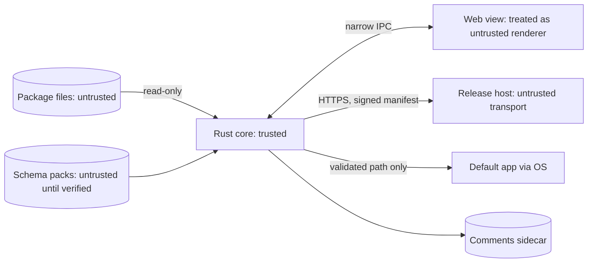

# Threat Model and Security Controls

Status: Draft v0.1. To be reviewed by maintainers and an external reviewer before 1.0.

## 1. System summary

Foliolight is a local desktop viewer. It reads package files from local or network folders, renders them in a web view (WebView2) driven by a Rust core, writes only its own comments sidecars and its own config, and optionally makes one network request to check for updates.

## 2. Assets

| Asset | Why it matters |
| --- | --- |
| Package contents (SSPs, assessment results, POA&Ms, attachments) | May describe system architecture and unremediated weaknesses. Often sensitive (for example, Controlled Unclassified Information). |
| Comments | Reviewer findings and opinions about vulnerabilities. Sensitive. |
| The user's workstation and credentials | Must not be put at risk by opening a hostile file. |
| Integrity of Foliolight releases | Agencies need to trust the binary they approve. |
| Integrity of schema packs | A malicious view could mislead a reviewer (for example, by hiding fields). |
| Project signing keys and repository | Compromise would let an attacker ship malicious releases. |

## 3. Actors

| Actor | Capability |
| --- | --- |
| Malicious or compromised file author | Crafts a package file, attachment, or link to exploit the parser, leak data, or run code. This is the primary threat: files come from many CSPs and their tools. |
| Malicious schema pack author | Publishes a pack that misleads reviewers or tries to smuggle executable content. |
| Network attacker | Intercepts or tampers with the update check or download. |
| Local user or malware on the same machine | Modifies config, sidecars, or the Foliolight folder. |
| Supply-chain attacker | Compromises a dependency, a GitHub Action, a maintainer account, or the build pipeline. |
| Well-meaning user | Accidentally shares sensitive data (for example, attaching a real package to a bug report). |

## 4. Trust boundaries

The web view is treated as if it could be compromised by rendered content. It therefore has no network access, no file system access, and can call only a short list of IPC commands, each of which validates its arguments in the core.

## 5. STRIDE summary

| Component | Spoofing | Tampering | Repudiation | Information disclosure | Denial of service | Elevation of privilege |
| --- | --- | --- | --- | --- | --- | --- |
| Parsers | n/a | Malformed input | n/a | XXE file reads, external fetches | Entity bombs, deep nesting, huge files | Memory corruption |
| Renderer (web view) | Content impersonating UI | Injected markup | n/a | Remote image beacons, leaking via URLs | Massive DOM | Script execution in web view |
| Launcher | Disguised file types | n/a | n/a | NTLM leak via UNC paths | n/a | Launching executables |
| Packs | Fake publisher | Modified pack | n/a | n/a | Oversized packs | Executable content |
| Comments | n/a | Edited sidecar | No audit trail | Sidecar travels with folder | Huge sidecar | Malformed sidecar exploits parser |
| Updater | Fake release | Modified download | n/a | Reveals usage to network | Hang on network | User tricked into running malware |
| Build and release | Maintainer impersonation | Compromised dependency or Action | Unsigned commits | Secret leakage in CI | n/a | Malicious release |

## 6. Threats and controls

### 6.1 Untrusted input parsing

| ID | Threat | Controls |
| --- | --- | --- |
| T-01 | XML external entities (XXE) read local files or make network requests | Any `DOCTYPE` is rejected. The XML parser (quick-xml) has no DTD or external entity support. Only the five predefined entities and numeric character references are accepted. |
| T-02 | Entity expansion bombs ("billion laughs") | DTDs rejected (T-01), so no custom entities exist. |
| T-03 | YAML alias bombs and type confusion | Aliases and anchors rejected by default; custom tags treated as strings; YAML 1.2 core schema. Size limit 64 MB. |
| T-04 | Deeply nested input exhausts the stack | Depth limit 256, enforced iteratively during parsing, not by recursion. |
| T-05 | Huge files or huge strings exhaust memory | File size limit, string and text node limits, node count limits, streaming index for large files, cancellation. |
| T-06 | Malformed input crashes the parser | Memory-safe Rust, no `unsafe` without review, fuzzing every parser (`cargo-fuzz`) in CI, hostile corpus regression tests. |
| T-07 | Regex denial of service in mapping rules or schemas | Rust `regex` crate guarantees linear-time matching; pattern length limits. |
| T-08 | Duplicate keys create ambiguity (one tool shows one value, Foliolight another) | Last value kept, warning shown, all locations listed so reviewers notice. |
| T-09 | Zip bombs and path traversal in archives (Phase 7) | Read in memory without extraction; limits on entry count, total expanded size, per-entry size, and compression ratio; entry names with `..`, absolute paths, drive letters, or device names rejected; nested archives not opened. |
| T-10 | Hostile image files exploit image decoders | Images are decoded by the web view's image decoders (patched with Edge), inside the renderer process. Magic bytes must match the declared media type. Size limits on decoded attachments. |

### 6.2 Embedded and linked content

| ID | Threat | Controls |
| --- | --- | --- |
| T-11 | Remote images or links act as tracking beacons or leak that a package is being reviewed | No remote fetches ever. Remote images in Markdown are replaced by a placeholder showing the URL. Content Security Policy blocks all network origins. |
| T-12 | Script injection through Markdown, HTML in fields, or SVG | Markdown rendered with raw HTML disabled, then sanitized. Field values are inserted as text, never as HTML. SVG is shown only through an image element (`` with a data or blob URL), where scripts do not run and external resources do not load. |
| T-13 | Content impersonates Foliolight UI (fake dialogs, fake "verified" badges) | Rendered content is visually contained in the viewer region; trust badges and security prompts are drawn only by the app shell, never by content. |
| T-14 | `javascript:`, `file:`, `data:` or custom-scheme links | Links from content are classified by the core. Only `http` and `https` (copy-only by default) and relative library paths (safe launcher) are actionable. All other schemes are shown as inert text. |

Web view hardening (Tauri):

- Content Security Policy: `default-src 'self'; script-src 'self'; style-src 'self'; img-src 'self' data: blob:; connect-src ipc: http://ipc.localhost; object-src 'none'; frame-src 'none'; base-uri 'none'; form-action 'none'`. No `unsafe-inline` and no `unsafe-eval`; the UI uses static CSS files, not runtime-injected styles.
- Navigation to any URL other than the bundled app is denied; new windows are denied.
- Developer tools disabled in release builds.
- Tauri capabilities grant only the app's own IPC commands. No shell plug-in, no general file system plug-in, no HTTP plug-in in the web view.
- The update check runs in Rust, so the web view never needs network access.

### 6.3 Paths and safe external launch

#### Path validation

| ID | Threat | Controls |
| --- | --- | --- |
| T-15 | Path traversal (`..\..\Windows\System32\...`) in content links | Relative links resolved against the file's folder, then canonicalized. The final path must be inside the library root. |
| T-16 | UNC paths or `file://server/...` links trigger SMB authentication and leak NTLM credentials | Paths from content that are UNC, `file://` with a host, or that resolve to a different volume than the library root are never opened, probed, or checked for existence. They are shown as inert text with an explanation. |
| T-17 | Symlinks and junctions escape the library | Reparse points are not followed by default; when allowed, the canonical target must remain inside the root. Final path checked after opening the handle (`GetFinalPathNameByHandle`) to avoid time-of-check and time-of-use races. |
| T-18 | Windows path quirks | Reject device names (`CON`, `NUL`, `COM1`, and others), `\\?\` and `\\.\` prefixes from content, alternate data streams (`file.txt:stream`), trailing dots and spaces, and short (8.3) name tricks by comparing canonical long paths. |

#### Safe external launch

Flow for "Open in default app":

1. The core receives a library-relative path (never a raw string from the web view to the OS).
2. Validate per T-15 to T-18.
3. Classify the extension:
   - **Always blocked** (fixed, not configurable): `.exe`, `.com`, `.bat`, `.cmd`, `.ps1`, `.psm1`, `.vbs`, `.vbe`, `.js`, `.jse`, `.wsf`, `.wsh`, `.hta`, `.msi`, `.msp`, `.msix`, `.appx`, `.scr`, `.pif`, `.cpl`, `.dll`, `.lnk`, `.url`, `.reg`, `.jar`, `.application`, `.appref-ms`, `.chm`, `.inf`, `.sys`, `.iso`, `.img`, `.vhd`, `.vhdx`, `.library-ms`, `.search-ms`, `.settingcontent-ms`, and files with no extension.
   - **Allowlisted**: configurable list (default in [app-config](../specs/app-config.md#3-settings-file)). Opens after a one-click confirmation on first use per session, showing the full path.
   - **Unknown**: confirmation dialog showing the path and type, or blocked by policy.
4. Launch with the operating system "open" verb (`ShellExecuteExW`) on the validated path, with **no arguments**, no `cmd.exe`, and no shell string building.
5. Mark-of-the-Web on the source file, if present, is preserved because Foliolight does not copy the file; the default application applies its own protections (for example, Office Protected View).

Decoded embedded attachments (for example, a base64 PDF) are never written to temporary folders automatically (ASSUMPTION A-20). The user may "Save as" to a chosen location; saved files receive Mark-of-the-Web (zone identifier) so the opening application treats them as untrusted.

### 6.4 Schema packs

| ID | Threat | Controls |
| --- | --- | --- |
| T-19 | Pack smuggles executable content | File type allowlist, no symlinks or hidden files, no HTML, no expressions in schemas; rejected otherwise. |
| T-20 | Tampered pack | `SHA256SUMS` verified on install and load; mismatch rejects the pack. |
| T-21 | Fake publisher | Minisign signature against a trust store; publisher name shown only as "verified" when the key is trusted. |
| T-22 | Misleading view (hiding critical fields) | Active schema always shown with its trust level; "View as" lets reviewers switch to the built-in or generic Outline view; Outline and Source views always available and never schema-controlled. |
| T-23 | Oversized packs | Size and file count limits. |

### 6.5 Local data sensitivity

| ID | Threat | Controls |
| --- | --- | --- |
| T-24 | Content persisted in caches or temp files | Listings and indexes held in memory only. No content caches on disk. WebView2 user data folder holds no package content (content is delivered over IPC, not as navigable resources); disk cache disabled where WebView2 allows. |
| T-25 | Logs leak sensitive data | Logging off by default (ASSUMPTION A-22); never logs content or comment text; paths only at debug level. |
| T-26 | Comments leak with folder copies or sync | Visible sidecar name, first-use warning, sync-root detection, export-based sharing guidance. See [comments-store](../specs/comments-store.md#9-sensitivity-warnings). |
| T-27 | Tampered sidecar | Sidecar parsed with the same safe YAML rules and limits; invalid entries skipped with a warning, never executed. There is no integrity protection against someone with write access to the folder; that is an accepted risk for v1. |
| T-28 | Comments store needs stronger protection | Out of scope for v1: rely on NTFS permissions and encrypted volumes. Optional encryption is an open question. |
| T-29 | Crash reports sent by Windows Error Reporting | Governed by OS policy; documented for administrators (risk R-13). Foliolight sends nothing itself. |
| T-30 | Real package data posted in public issues | Issue templates warn; maintainers remove and purge sensitive attachments; SECURITY.md explains how to share safely. |

### 6.6 Update channel

| ID | Threat | Controls |
| --- | --- | --- |
| T-31 | Fake or modified release | `latest.json` and `SHA256SUMS` are signed with a project minisign key embedded in the binary; downloads verified against both. Authenticode signature on executables is an additional check for the user and for AppLocker or WDAC. TLS protects transport but is not relied on for integrity. |
| T-32 | Downgrade or replay | Only versions strictly newer than the running version are offered; the manifest includes version and release date and is signed. |
| T-33 | Key compromise or loss | Two release public keys embedded (current and next). Rotation documented in the release runbook. Secret keys held offline or in a hardware-backed store, accessible only to the release environment. |
| T-34 | Update check reveals usage | The request contains no identifiers beyond what HTTPS inherently reveals (IP, standard user agent with version). The check is off until opted in (ASSUMPTION A-15) and can be disabled by policy. |
| T-35 | Network hangs the app | 5 second timeout, background thread, never blocks UI. |
| T-36 | User tricked into running a download | Foliolight never runs downloads. It verifies them and opens the folder. |

### 6.7 Supply chain

| Control | Detail |
| --- | --- |
| Dependency minimization | Each new dependency needs a justification in the pull request; prefer the standard library and well-maintained crates. |
| Pinning | `Cargo.lock` and `package-lock.json` committed; `cargo build --locked`; `npm ci --ignore-scripts`; Rust toolchain pinned in `rust-toolchain.toml`; Node version pinned. |
| Vulnerability scanning | `cargo audit` (RustSec) and `npm audit` on every pull request and nightly. |
| Policy enforcement | `cargo-deny` for licenses, advisories, banned crates, and allowed sources (crates.io only). npm license checker in CI. |
| GitHub Actions | Pinned by full commit SHA; minimal `permissions`; no `pull_request_target` with checkout of untrusted code; secrets only in protected release environment. |
| Repository protection | Branch protection on `main`, required reviews, required status checks, signed commits required, CODEOWNERS for sensitive paths, no force pushes. |
| Releases | Built only from signed tags in CI; signing job in a protected environment requiring approval from two maintainers. |
| SBOM | CycloneDX SBOM for Rust and npm dependencies, merged and attached to every release. |
| Provenance | GitHub artifact attestations (Sigstore-based build provenance) for every artifact. |
| Reproducibility | Best effort: pinned toolchains, `SOURCE_DATE_EPOCH`, locked dependencies, documented build environment. Full bit-for-bit reproducibility on Windows is a stretch goal. |
| Project health | OpenSSF Scorecard run in CI and published. |

### 6.8 Locked-down Windows environments

| Environment control | Expected behavior and guidance |
| --- | --- |
| No admin rights | Fully supported. Nothing requires elevation. |
| AppLocker default rules | Default rules allow executables only from `Program Files` and `Windows`. Running from Downloads, the desktop, or USB is blocked. Agencies should place the portable folder in an approved path or create a **publisher rule** (requires our stable signing identity) or **hash rule** (we publish SHA-256 hashes; note that AppLocker hash rules use its own file hash, which administrators generate from the signed binary with standard tooling). |
| WDAC (App Control for Business) | Signed binaries allow signer-based rules. Smart App Control on Windows 11 blocks unsigned apps, so signing is required. |
| SmartScreen | Reputation-based. Signing with a well-established identity reduces warnings; new identities and new versions may still warn until reputation builds. |
| Controlled Folder Access (Defender) | May block sidecar writes in protected folders such as Documents; Foliolight reports this as "not writable" and disables commenting there. |
| Redirected or roaming profiles | Config lives in `%APPDATA%` (roams) and WebView2 data in `%LOCALAPPDATA%`; portable mode avoids the profile entirely. |
| Restricted outbound network or TLS inspection | Update check uses the system proxy and the operating system certificate store (Schannel), so inspection certificates trusted by the OS work. Failure is silent apart from the status icon. |
| No WebView2 runtime (Server images) | Clear startup message with remediation, and the fixed-version build alternative. |
| FIPS mode enabled | TLS is handled by Schannel and follows OS FIPS policy. See [release plan](../release/release-and-distribution.md#fips-and-cryptography). |

## 7. Vulnerability disclosure

See [SECURITY.md](../../SECURITY.md): GitHub private vulnerability reporting, acknowledgment target of 5 business days, fix targets by severity, coordinated disclosure, and advisories published through GitHub Security Advisories.

## 8. Residual risks accepted for v1

- No integrity protection for sidecars against users with folder write access.
- No encryption of comments.
- Image decoding relies on the WebView2 engine's patch level (Evergreen is patched by Microsoft; the fixed-version build depends on our releases).
- Windows Error Reporting behavior is controlled by the OS.
