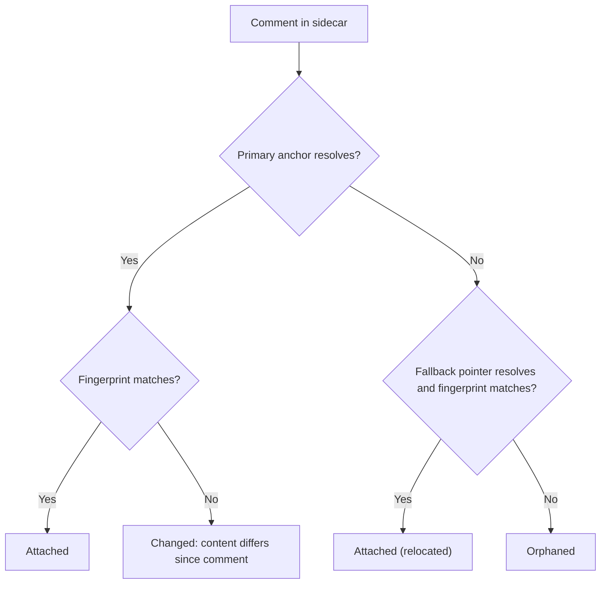

# Specification: Comments Store v1

Status: Draft v0.1. Spec ID: `foliolight/comments/v1`.

## 1. Purpose and decisions

Reviewers attach comments to a specific file and a specific location in it. Comments are stored locally only.

Owner decisions:

- Comments live in a **sidecar file in the same folder as the source files**, one per document-type folder.
- Comments must **survive across file versions** as long as the identifier of the control or area they refer to still exists.
- If the folder is **not writable**, commenting is **disabled** for that folder, with an explanation.
- Assume **one reviewer at a time** per library.

## 2. Why per folder, not per file

A per-file sidecar would be tied to one version (`ssp-2026-07.json`) and would have to be migrated every time a newer file arrives. A per-folder sidecar covers the whole version group, so a comment on control AC-2 in July's SSP automatically appears on AC-2 in October's SSP.

## 3. Location and name

- Path: `<CSP folder>/<document-type folder>/.foliolight-comments.yaml` (ASSUMPTION A-08).
- Created only when the user adds the first comment in that folder.
- Excluded from library listings and from format detection.
- On Windows, the leading dot does not hide the file. That is intentional: users should be able to see that review notes are present.

## 4. Format

YAML safe subset (no anchors, aliases, or tags), UTF-8, written in a stable order (comments sorted by `id`, keys in a fixed order) so diffs stay readable.

```yaml
apiVersion: foliolight/comments/v1
kind: CommentStore
scope:
  csp: Aster Example Cloud          # informational; actual scope is the folder
  documentType: SSP
comments:
  - id: 01JBQ6Z7X4M9T2K8V3N5R0PWDA  # ULID: sortable and unique
    anchor:
      kind: oscal-control-id        # see Section 5
      value: ac-2
      model: system-security-plan
      fallback:
        jsonPointer: /system-security-plan/control-implementation/implemented-requirements/14
        xpath: /oscal:system-security-plan/oscal:control-implementation/oscal:implemented-requirement[15]
    fingerprint: sha256:4f1c...a9   # canonical hash of the anchored node when last confirmed
    excerpt: "Account management is implemented through the central identity service..."
    seenIn:
      - file: ssp-2026-07.json
        sha256: 7d0e...41
        state: attached
        at: 2026-08-03T14:22:05Z
      - file: ssp-2026-10.json
        sha256: c2b9...0f
        state: changed
        at: 2026-10-14T09:10:44Z
    author: J. Reviewer             # free text (ASSUMPTION A-09)
    created: 2026-08-03T14:22:05Z   # UTC ISO 8601 (ASSUMPTION A-12)
    updated: 2026-10-14T09:12:01Z
    status: open                    # open | resolved | accepted-risk | info
    severity: moderate              # optional: low | moderate | high
    tags: [account-review]
    text: |
      Clarify the frequency of privileged account reviews.
```

Field notes:

- `excerpt` stores up to 300 characters of the anchored content when the comment was created, so a reviewer can see what the comment referred to even if it later orphans. It can be disabled by setting (`comments.storeExcerpts: false`) for sensitive environments, at the cost of a weaker orphan experience.
- `text` is plain text with a small safe Markdown subset (ASSUMPTION A-16).
- `seenIn` keeps at most the last 20 entries per comment.

## 5. Anchor kinds

Anchors are tried in order of stability. The UI picks the most stable kind available when a comment is created.

| Kind | Value | Stable across versions? | Formats |
| --- | --- | --- | --- |
| `oscal-control-id` | Control ID such as `ac-2` or `ac-2.1` | Yes | OSCAL |
| `oscal-uuid` | Object UUID (for example, a POA&M item, finding, component) | Usually: OSCAL UUIDs are meant to be stable, but some tools regenerate them | OSCAL |
| `schema-key` | A `rowKey` value defined by the active view schema (for example, a POA&M item ID) | Yes, when the key is stable | Any with a view schema |
| `json-pointer` | RFC 6901 pointer | No: shifts when items are inserted | JSON, YAML |
| `xpath` | Simplified XPath with positional predicates | No | XML |
| `line-range` | `start-end` lines | No | Any text |
| `file` | The document type as a whole | Yes | Any |

Each comment has one primary anchor and optional structural fallbacks.

## 6. Fingerprints

The fingerprint is a SHA-256 hash of a canonical form of the anchored node:

- **JSON and YAML**: converted to the JSON model and serialized with RFC 8785 JSON Canonicalization Scheme (sorted keys, normalized numbers and strings).
- **XML**: a simplified canonical form: element and attribute names with namespace URIs, attributes sorted, whitespace-only text dropped, other text trimmed.

The same content in JSON and XML yields different fingerprints. When a CSP switches formats, comments still resolve by stable anchor and show **Changed** once; confirming them updates the fingerprint.

Fingerprints and file hashes are used for change detection, not as a security control.

## 7. Resolution and drift

When the user opens a file, each comment in that folder's sidecar is resolved against it.



| State | Meaning | UI |
| --- | --- | --- |
| Attached | Same anchor, same content | Shown in place |
| Attached (relocated) | Found by fallback pointer with identical content | Shown in place with a small "moved" note |
| Changed | Anchor found, content changed | Shown in place with a "content changed since this comment" badge and the stored excerpt for comparison. Actions: Confirm (updates fingerprint), Reopen, Resolve |
| Orphaned | Anchor not found in this file | Listed in an "Orphaned" group in the comments panel. Actions: Re-anchor (pick a node), Convert to file-level, Resolve, Delete. Never deleted automatically |

Drift detection triggers:

- The file's SHA-256 differs from the latest `seenIn` entry (computed in the background after open).
- The user opens an older version: comments resolve against that file too, and `seenIn` records the result, so a reviewer can see when an issue appeared or disappeared.

## 8. Writes

- **Writability check**: when the user first starts a comment in a folder, Foliolight attempts to create and delete a temporary file there. If that fails (read-only share, permissions, Controlled Folder Access, policy), commenting is disabled for that folder and the panel explains why and what to ask IT for.
- **Atomic write**: write `.foliolight-comments.yaml.tmp`, flush, then replace the original. If the replacement fails, the original is untouched and the user is told.
- **External change check**: before every write, compare the sidecar's size, modified time, and hash with what was loaded. If it changed (for example, edited by hand or synced), reload and merge by comment `id`; if the same comment changed on both sides, keep both versions and ask the user which to keep.
- Writes happen only on explicit user actions (add, edit, change status, delete, confirm, re-anchor).

## 9. Sensitivity warnings

The first time a user adds a comment in a library, Foliolight shows a one-time notice (repeatable from Help):

- Comments are saved next to the package files in `.foliolight-comments.yaml`.
- Anyone who can read the folder can read the comments.
- If the folder is copied, zipped, or sent to someone (including back to a CSP), the comments go with it.
- If the folder is synced (for example, OneDrive), the comments are synced too.
- To share findings deliberately, use **Export**.

If the library path is inside a known sync root (OneDrive, SharePoint sync), the notice says so explicitly.

## 10. Export

| Format | Content |
| --- | --- |
| Markdown | Grouped by CSP, then document type, then status. Includes anchor label, state, excerpt (optional), and text. |
| CSV | One row per comment. RFC 4180. Cells starting with `=`, `+`, `-`, `@`, tab, or carriage return are prefixed with a single quote to prevent spreadsheet formula injection. UTF-8 with byte order mark for Excel compatibility. |
| JSON | The comments v1 structure plus resolved state, current file, and resolved location. |

Export scope can be one folder, one CSP, or the whole library, and can be filtered by status, severity, or tag. Exports are written only where the user chooses.

**Interoperability** (future): mapping comments to OSCAL assessment-results observations or findings is an [open question](../community/open-questions.md#6-comment-portability).

## 11. Protection

- Sidecars inherit the folder's NTFS permissions. Foliolight does not change permissions.
- Encryption of the comments store is out of scope for v1. Agencies that need it should rely on folder permissions or encrypted volumes.
- Comment text is never logged.
