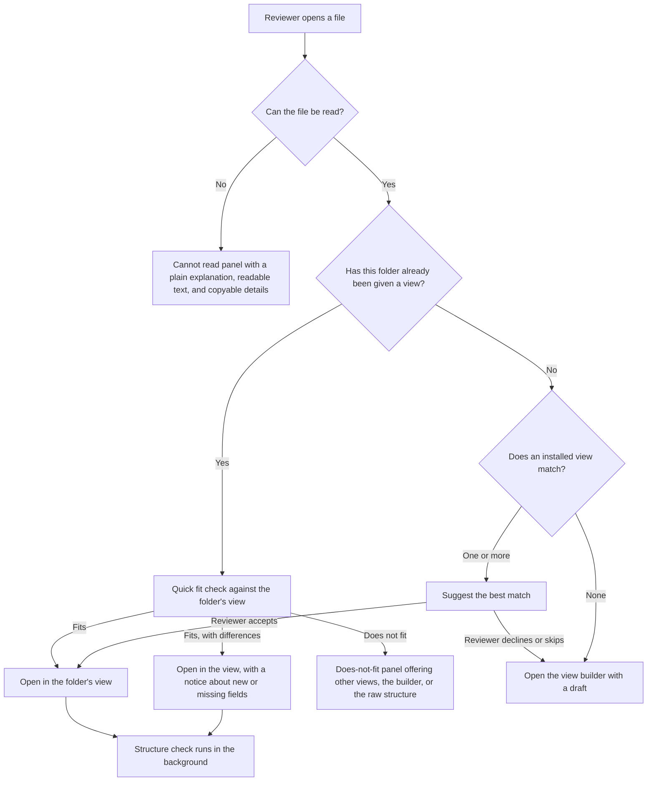

# Specification: Opening Files, Choosing Views, and Checks on Open

Status: Draft v0.1. Responds to [issue #6](https://github.com/foliolight/foliolight/issues/6) and owner direction of 2026-11-20.

## 1. Goals

- A reviewer who does not know what a schema or a machine-readable format is can still open any file and get to a useful screen.
- Every file opens. A problem with the view never stops the reviewer from seeing the raw content.
- Checks are fast and never block reading.
- Problems are explained in plain language, with one obvious next step.

### Vocabulary in the UI

The interface never says "schema." It says **view** (how a kind of file is displayed) and **fields** (the named pieces of data in a file). The specs keep the technical terms.

## 2. The flow



At every point, **Outline** and **Source** remain one click away, so the reviewer can always see what is in the file.

## 3. Choosing a view the first time

When a file is opened in a document-type folder that has no view yet:

1. **Match.** Compare the file against every installed view (built-in, packs, the user's own) using each view's `match` rules: format, OSCAL model and version, `$schema` value, root key, and the paths the view requires. Matching reads only what detection already read (the first 64 KB) plus the top of the structural index, so it takes milliseconds.
2. **Suggest.** If one or more views match, show the best one first:

   ```
   This looks like a vulnerability report.
   Foliolight has a view for it: "Vulnerability report dashboard" (Example Publisher, verified).
   [Use this view for this folder]  [Use it just for this file]  [See other views]  [Build my own view]
   ```

   "Use this view for this folder" saves a binding for the folder (Section 6) so every file in it opens the same way.
3. **Build.** If nothing matches, or the reviewer chooses "Build my own view" or closes the suggestion without choosing, the [view builder](ui.md#5-schema-builder) opens with a draft inferred from the file, already showing a preview. The reviewer can save it for this folder, or skip and just look at the Outline.

## 4. Informational structure check

When the file declares or is known to follow a published schema, and that schema is available locally, Foliolight checks the file against it in the background.

- **Where the schema comes from:** bundled with the app (OSCAL JSON schemas, and the JSON schemas FedRAMP publishes, see [bundled-program-schemas](bundled-program-schemas.md)) or shipped in a pack (`structureSchema`, see [view-schema](view-schema.md#15-structure-schema-informational-check)). Schemas are never downloaded. A schema reference (`$ref`) that points outside the local schema files is not followed, and the result says the check was partial.
- **When:** after the first page appears, on a background thread. It never delays opening.
- **Result:** a status bar item and a panel:

  ```
  Structure check (informational): 3 issues
  Compared with: OSCAL 1.1.2 system security plan (bundled)
    - Line 1,204: "implementation-status" must be one of: implemented, partial, planned, alternative, not-applicable. Found: "in progress".
    - Line 2,881: required field "party-uuid" is missing.
    - ...
  This is not a compliance or conformance determination.
  ```

- **Limits:** stops after 200 issues and a 10-second budget for very large files, and says so. Results are kept for the session only.
- **Wording for program schemas:** the result names the schema and its date, says a file that differs may still be acceptable, and never says "valid for submission" or "compliant." The check can be switched off per bundled pack.
- **Phasing:** OSCAL JSON and the bundled FedRAMP schema files in Phase 2. Pack-supplied schemas and the bundled pack's views in Phase 4. OSCAL XML (XSD) in Phase 7.

## 5. Opening a file in a folder that already has a view

The **quick fit check** compares the file with the folder's view using its [fit rules](view-schema.md#14-fit-rules).

- **What it reads:** the top of the structural index and a sample of records (500 by default, ASSUMPTION A-29) from each dataset. It does not wait for the whole file to be indexed. For large files it re-checks quietly when indexing completes and updates the notice only if the result changes.
- **Target speed:** under 200 ms for typical files, measured as part of the [performance budgets](../testing/test-strategy.md#6-performance-budgets).

### Outcomes

| Outcome | What it means | What the reviewer sees |
| --- | --- | --- |
| **Fits** | Required and expected fields are present; no significant new fields. | Nothing extra. The status bar shows which view is in use. |
| **Fits, with differences** | Required fields are present, but some expected fields are missing, or the file has new fields the view does not show. | The view opens normally with a notice (5.1). |
| **Does not fit** | One or more required fields are missing, or the file is a different kind of document. | The file opens in Outline, with a panel explaining why (5.2). |
| **Cannot read** | The file is damaged, incomplete, too large, or uses something Foliolight refuses for safety (for example, an XML DTD). | A panel explaining why (5.3). The builder is not offered because there is nothing reliable to build from. |

### 5.1 Fits, with differences

```
This file has 4 fields this folder's view doesn't show yet,
for example "remediation owner" and "vendor dependency".
2 fields the view expects are missing, so the "Due date" and "Owner" columns are blank for this file.

[Add the new fields to this folder's view]  [Not now]  [Don't show this again for these fields]
```

- **Add the new fields** opens the builder at the right step, with the new fields pre-selected and a live preview. Saving updates the folder's view.
  - If the folder's view came from the app or a pack, Foliolight saves a **personal copy** that extends it (`extends`), so the original stays unchanged and pack updates still apply underneath.
  - The builder also offers **Save as a new view** for when this file really is a different variant, which can then be bound to files that match a name pattern (Section 6).
- **Don't show this again** adds those fields to the view's hidden list for this folder.
- Missing expected fields are only a notice. Charts that need them show "No data for this chart in this file."

### 5.2 Does not fit

```
This file doesn't look like the others in this folder.
This folder uses the "Vulnerability report dashboard" view, which needs a list of findings.
This file looks like a system security plan instead.

[Open it with the System security plan view]  [Build a view for this file]  [Show the raw structure]
Is this file in the wrong folder?  [Show in File Explorer]  [Treat files like this as a different document type]
```

- The most likely matching views are offered first.
- **Build a view for this file** opens the builder with a draft from this file.
- **Foliolight does not move the file.** Moving or renaming package files is outside the read-only principle. Instead:
  - **Show in File Explorer** lets the reviewer move it themselves.
  - **Treat files like this as a different document type** adds a mapping rule in the app config (for example, files named `*ssp*` in this folder belong to SSP), with no change on disk.

### 5.3 Cannot read

```
Foliolight couldn't read this file.
It looks damaged or incomplete: the data ends unexpectedly about 92% of the way through.

[Show the readable part as text]  [Copy technical details]
Technical details (for your IT team or the provider): JSON parse error at line 48,201, column 17: unexpected end of input.
```

Each refusal reason has its own plain-language sentence, for example:

- "This file is larger than the 512 MB limit set for this computer."
- "This file uses an XML feature Foliolight blocks for safety (a DTD). Ask the provider for a version without it."
- "This file is stored in the cloud and couldn't be downloaded by your sync app."

## 6. Folder views (bindings)

- A binding links a view to a document-type folder for one CSP, or to a file name pattern inside it. Bindings are stored in the app config (`schemaBindings`), not in the library, so nothing is written next to package files.
- The status bar and the view chooser always show which view is in use and why ("chosen for this folder").
- Changing the folder's view later, or clearing it, is available from the view chooser and from the folder's context menu.

## 7. Accessibility

- Notices and panels are regions with headings. A notice is announced politely once when it appears, and buttons are reachable in normal tab order. The UI never steals focus without a user action.
- No outcome depends on color. Each has an icon, a heading, and plain text.
