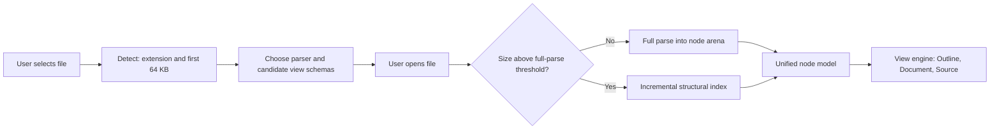
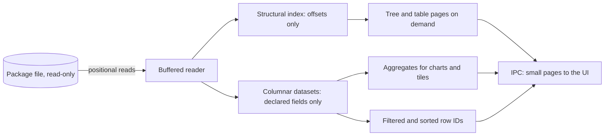

# Specification: Parsers, Formats, and Large-File Handling

Status: Draft v0.1.

## 1. Goals

- Treat every file as structured data first, with format knowledge (such as OSCAL) layered on top.
- Parse untrusted input safely, with hard limits.
- Stay responsive on files of tens or hundreds of megabytes.
- Let the community add formats through a small, well-defined interface.

## 2. Pipeline



## 3. Detection

Detection runs in stages and records a confidence for each candidate. It reads at most the first 64 KB and only after the user selects a file.

| Stage | Signal | Example |
| --- | --- | --- |
| 1. Extension | `.json`, `.xml`, `.yaml`, `.yml`, `.csv`, `.sarif`, and others | `ssp.json` |
| 2. Content sniff | Byte order mark, first non-whitespace character (`{`, `[`, `<`), YAML document marker or key pattern | `<?xml` |
| 3. Schema hints | JSON `$schema`, XML root namespace, SARIF `version` plus `runs`, CycloneDX `bomFormat`, SPDX `spdxVersion` | `http://csrc.nist.gov/ns/oscal/1.0` |
| 4. OSCAL model and version | JSON or YAML root key, or XML root element, plus `metadata/oscal-version` | `system-security-plan`, `1.1.2` |
| 5. View schema match | `match` rules in installed view schemas (see [view-schema spec](view-schema.md#4-match-rules)) | `builtin:oscal/ssp` |

When the extension and content disagree (for example, XML content in a `.json` file), content wins, and the status bar shows "Detected as XML (file extension says JSON)."

OSCAL root identifiers recognized in v1:

| Model | JSON or YAML root key | XML root element |
| --- | --- | --- |
| System Security Plan | `system-security-plan` | `system-security-plan` |
| Assessment Plan | `assessment-plan` | `assessment-plan` |
| Assessment Results | `assessment-results` | `assessment-results` |
| Plan of Action and Milestones | `plan-of-action-and-milestones` | `plan-of-action-and-milestones` |
| Catalog | `catalog` | `catalog` |
| Profile | `profile` | `profile` |
| Component Definition | `component-definition` | `component-definition` |

ASSUMPTION A-06: OSCAL 1.1.x and later 1.x are supported; version comes from `metadata/oscal-version`.

## 4. Unified node model

All parsers produce the same tree so that views, search, comments, and FPath work across formats.

| Field | Meaning |
| --- | --- |
| `id` | Session-local numeric node ID. |
| `kind` | `object`, `array`, `element`, `attribute`, `text`, `scalar`. |
| `name` | Key (JSON or YAML), element or attribute name (XML, with namespace prefix resolved to URI). |
| `value` | For scalars: a string preview (up to 4 KB; full value loaded on demand). Numbers keep their original text to avoid precision loss. |
| `childCount` | Number of children, if known (may be "unknown yet" while indexing). |
| `span` | Byte offsets `[start, end)` in the source file. |
| `line` | Starting line number, for Source view and line-range anchors. |
| `pointer` | Canonical location: JSON Pointer (RFC 6901) for JSON and YAML; a simplified XPath (`/ns:root/ns:child[3]/@attr`) for XML. |

XML mixed content (text interleaved with elements) is preserved as ordered `text` and `element` children.

## 5. Parser interface (for contributors)

Described in prose and pseudocode; the real interface is defined in Phase 0.

```
trait FormatParser {
    id() -> "json" | "xml" | "yaml" | ...
    sniff(first_bytes, file_name) -> Option<Confidence>
    parse_full(reader, limits, cancel) -> Result<NodeArena, ParseError>
    build_index(reader, limits, progress, cancel) -> Result<StructuralIndex, ParseError>
    read_children(index, node_id, offset, count, limits) -> Result<Vec<Node>, ParseError>
}
```

Requirements for any new parser pull request:

1. Enforces every limit in Section 7 and honors cancellation.
2. Performs no network or file access beyond the reader it is given.
3. No `unsafe` code unless reviewed and justified in the pull request.
4. Includes a `cargo-fuzz` target, valid and malformed fixtures, and hostile-input cases relevant to the format.
5. Uses only dependencies that pass the [dependency license policy](../community/licensing-and-governance.md#dependency-license-policy).

Runtime plug-ins (DLLs, scripts, WebAssembly) are not supported in v1. This keeps the binary auditable and the threat model small.

## 6. Large-file strategy

| File size (default thresholds) | Strategy |
| --- | --- |
| Up to 16 MB | Full parse into a compact node arena. |
| 16 MB to 512 MB | Incremental structural index. The parser streams the file once, recording byte offsets of containers down to a configurable depth (default 4). Children deeper than that are parsed on demand by seeking to the container's offset and parsing only that range. |
| Over 512 MB | Refused by default with a clear message. A user setting can raise the limit (ASSUMPTION A-07). |
| YAML over 64 MB | Refused by default. YAML cannot be safely random-accessed, so it is always fully parsed; very large YAML is rare. |

Details:

- **JSON**: a byte-level structural scanner finds container boundaries and string extents without allocating values. serde_json parses each requested subrange.
- **XML**: quick-xml's streaming reader records element start offsets and nesting. Subtrees are re-read from their offsets on demand.
- **Indexing runs in a background thread** with progress events. The first page of the tree appears as soon as the top levels are indexed.
- **Memory budget**: the index stores offsets and small metadata only; target under 10 percent of file size.
- **Search** runs on a background thread over the file in chunks, streams results as found, and is cancellable.
- **Source view** reads and highlights only the visible line window, using a line-offset index built during the first pass.
- **Hashing** (for comment drift) runs as a streaming SHA-256 in the background after open.

## 7. Safety limits

Defaults (ASSUMPTION A-07). Policy can lower them; users can raise some of them.

| Limit | Default | Applies to |
| --- | --- | --- |
| Maximum file size | 512 MB | All |
| Maximum nesting depth | 256 | All |
| Maximum single string or text node | 64 MB | All |
| Maximum nodes (full-parse mode) | 20 million | All |
| Maximum attributes per element | 1,024 | XML |
| Maximum name length | 1,024 bytes | XML, JSON keys, YAML keys |
| DOCTYPE or DTD | Rejected with a clear message | XML |
| Entity references other than the five predefined and numeric character references | Rejected | XML |
| Aliases and anchors | Rejected by default | YAML |
| Custom tags | Treated as plain strings | YAML |
| Duplicate keys | Last value kept, warning shown, both locations listed | JSON, YAML |
| Invalid UTF-8 | Displayed with replacement characters and a warning | All |
| Decoded base64 attachment | 25 MB | OSCAL back-matter and others |

YAML is interpreted with the YAML 1.2 core schema, so values like `no` and `on` remain strings, not booleans.

## 8. OSCAL module

- Builds a **UUID index** for the open document (on demand for large files) so `#uuid` links, `party-uuid`, `component-uuid`, and similar references can be followed with one click.
- Resolves **back-matter resources**: `base64` content is decoded (within limits) for inline display of images; `rlinks` to relative paths inside the library become safe launch links; `rlinks` to remote URLs are shown as copyable text.
- Renders `markup-line` and `markup-multiline` fields as Markdown with raw HTML disabled and remote images replaced by a placeholder showing the URL.
- Shows `import-profile`, `import-ssp`, `import-ap`, and catalog imports as links. Relative imports that resolve inside the library can be opened. Remote imports are never fetched, and profile resolution is not performed in v1.
- Exposes `props` with their `ns` values, so partner packs can target extension properties without core changes.

## 9. Format roadmap

| Format | Phase | Notes |
| --- | --- | --- |
| JSON, XML, YAML (generic) | 1 | Outline and Source views |
| OSCAL (all six model families) | 1 (generic OSCAL view), 2 (built-in Document views) | |
| CSV | 7 | RFC 4180, delimiter sniffing, table view |
| XLSX (read-only) | 7 | Many POA&M deliverables are spreadsheets. Values only; formulas shown as text, never evaluated; macros ignored. |
| SARIF | 7 | Results table grouped by rule and severity |
| CycloneDX (JSON, XML) | 7 | Components, licenses, vulnerabilities |
| SPDX (JSON, tag-value) | 7 | Packages, relationships, licenses |
| Markdown | 7 | Safe rendering, no raw HTML |
| Zip archives (read-only) | 7 | Read in memory without extraction; strict limits on entry count, total expanded size, compression ratio, and path names |
| PDF, DOCX, VSDX, draw.io | Not planned in-app | Open in the default application through the safe launcher |

## 10. Optional schema validation (Phase 7)

Foliolight may bundle published OSCAL JSON Schemas to show **informational** validation results (never a compliance determination). Licensing of bundled schemas must be reviewed against the dependency policy before inclusion.

## 11. Document sessions and memory model

### Goals

Low memory and CPU on ordinary agency laptops and virtual desktops, a responsive UI even for files of hundreds of megabytes, and no copies of package content on disk.

### Decision: no database; per-document in-memory sessions

Foliolight does **not** import files into a database, whether SQLite, DuckDB, or anything else. Each opened document gets an in-memory **session**. The session holds only what the current views need and is freed when it is evicted.

| Option considered | Why not chosen |
| --- | --- |
| Load the whole file into memory as objects (typical web app approach) | A 300 MB JSON file becomes several gigabytes of objects. Slow to open and heavy on virtual desktops. |
| Import into an on-disk database (SQLite, DuckDB) | Writes a second, harder-to-find copy of sensitive package content to disk (threat model T-24). Import adds a full write pass before anything shows. Leaves leftover files after a crash. DuckDB would also add tens of megabytes to a release that is meant to stay small. |
| In-memory SQLite | Workable, but our queries are simple: filter, group, count, sort, page. A purpose-built columnar table is smaller and faster for those queries and adds no dependency. This is the fallback if cross-document features (library-wide search, trends across versions) are added later. It would still never be written to disk. |
| **Session with structural index plus columnar datasets (chosen)** | One streaming pass, small memory footprint, fast aggregation, nothing persisted. |

### What a session contains



| Part | Content | Typical size |
| --- | --- | --- |
| File identity | Path, size, modified time, SHA-256 (computed in the background) | Bytes |
| Node arena (files up to 16 MB) or structural index (larger files) | See Section 6 | Index target under 10 percent of file size |
| UUID and ID index | Maps OSCAL UUIDs and control IDs to byte offsets | Small |
| Datasets | For each dataset the active view declares: one row per record, only the declared fields, stored as typed columns with repeated strings deduplicated | For example, 200,000 findings with 10 fields is roughly 20 to 40 MB |
| Caches | Recently parsed subtrees, recent query results, search hits | Capped, least recently used entries dropped first |

### How the file is read

- The file is opened read-only with full sharing (see [library-convention](library-convention.md#10-opening-files-read-only)) and read with **positional, buffered reads**. Nothing is copied anywhere else.
- Memory-mapping is used only for files on local fixed disks, and only if the Phase 0 spike shows a measurable gain. A mapped file on a network share, or one truncated by a sync tool, fails with a page fault instead of a normal read error, which is much harder to handle gracefully.
- **One streaming pass** builds the structural index, the line index for Source view, and every dataset the view needs, all at the same time. The background hash runs as a separate low-priority pass.
- If the user switches to a view that needs a dataset not yet built, only the records' byte ranges are re-read, using the index. The whole file is not re-parsed.

### Session lifecycle

- **Open**: the session is created and the first page appears as soon as the top levels are indexed. Tiles and charts show "Counting..." and fill in when the dataset pass finishes.
- **Switching documents**: the previous session stays in a small most-recently-used list, so switching back is instant. Defaults: at most 3 sessions or 768 MB total, whichever is reached first (ASSUMPTION A-26). Anything beyond that is freed.
- **Close or evict**: memory is released. Nothing about the content is written to disk.
- **Memory pressure**: when Windows signals low memory, inactive sessions are freed first.
- **File changed on disk**: the session is marked stale and the user is offered a reload (see library-convention Section 10).

### Keeping the UI responsive

- The web view never holds a whole document. It asks for pages (50 to 200 rows or tree nodes) and receives small results. Chart results are a few category counts.
- Every query carries a generation number. Typing in a filter cancels outdated queries, and input is debounced (about 150 ms).
- The next page is prefetched while the user scrolls.
- All parsing, indexing, aggregation, and search runs on core worker threads, never on the UI thread. The thread pool is capped at half the available cores so the rest of the machine stays usable.
- On virtual desktops with 2 cores, indexing runs on one worker thread and the UI stays interactive.

### Budgets

See [test strategy](../testing/test-strategy.md#6-performance-budgets). Dataset-specific targets: building a 200,000-record dataset during the first pass adds less than 20 percent to open time, and recomputing every chart on a dashboard after a filter change takes less than 100 ms.
